# Архитектура nexigen

Документ описывает устройство платформы `nexigen-cpp`: состав модулей, их
границы, зависимости и взаимодействие компонентов в рантайме. Он собран по
публичным заголовкам `include/nexigen/`, спецификациям `openspec/specs/` и
целям сборки `CMakeLists.txt`.

Актуально на 18.11.2026: 14 модулей и 401 заголовок в `include/nexigen/`
(включая `detail/`). Основной корпус OpenSpec — 129 capability, 929 требований
и 2409 сценариев (включая `synchro`, добавленный архивированным change
`add-synchro-event-sync`).

## 1. Назначение и принципы

`nexigen-cpp` — библиотека C++23 для Linux для систем жёсткого реального
времени и симуляторов аппаратуры. Платформа даёт приложению готовые
примитивы времени, телеметрии, межпроцессного обмена, супервизии процессов,
управления состояниями и наблюдаемости.

Инварианты, общие для всех модулей:

- **Контракт первичен.** Поведение описывается capability-спецификациями в
  `openspec/specs/<module>/<capability>/spec.md`; код приводится к спецификации,
  а не наоборот.
- **Ошибки без исключений.** Глобальные `-fno-exceptions -fno-rtti`; публичные
  fallible-API возвращают `core::Result<T, ErrorCode>` (или `core::Status`).
  Ветвление — по `has_value()`/`.error()`, вызов `.value()` запрещён.
- **Горячий путь без выделения памяти и блокировок.** Производитель пишет
  только в свой SPSC-shard; форматирование, JSON и файловый ввод-вывод
  вынесены на холодный путь.
- **Один namespace — один модуль.** Внутренности живут в `detail/` и не
  являются публичным контрактом. Зависимости направлены только вниз.
- **Опциональный COM-слой.** Всё, что требует iceoryx2 (Rust), собирается
  только при `NEXIGEN_ENABLE_COM=ON`; остальные модули от него не зависят.
- **Сериализация как мандат.** Публичные типы имеют холодные `to_string()`,
  ADL `to_json`/`from_json` (при `JSON_NOEXCEPTION=1`), а перечисления —
  `constexpr to_string`/`from_string` и `std::formatter`.
- **Концепты для развязки.** Общие структурные контракты (`Message`,
  `LevelLogger`, `Logger`, `Sink`, `LifecycleSink`, `CounterLike`, `GaugeLike`,
  `StateGaugeLike`, `DescriptiveStatisticsLike`, `HistogramLike`, `MeterLike`) живут в
  `nexigen::core::concepts`; доменные концепты остаются в своих модулях.
  Sink-и доставляют через `on_event()`/`flush()`, lifecycle-часть —
  `start()`/`stop()`, и связываются общим `core::SinkBinding<Event>`.
  Компонент получает `Meter` и создаёт инструменты сам; указатели на
  инструменты не передаются в другие модули. Выданные хэндлы — заимствованные:
  они memory-safe, пока жив объект `Infrastructure` (до его разрушения), а
  `shutdown()` останавливает подсистемы (quiesce) и не освобождает их память.
  Полный контракт — ADR `docs/adr/0002-telemetry-handle-lifetime.md`.

## 2. Карта модулей

| Слой | Модуль | CMake-цель | Тип | Заголовки | Назначение |
|---|---|---|---:|---:|---|
| L0 | `nexigen::core` | `nexigen_core` | INTERFACE | 25 | `Result`/`ErrorCode`, сериализация, `LogLevel`, enum-словари, SPSC-очереди, потоки и affinity, sink/settings-инфраструктура, integrity-примитивы |
| L1 | `nexigen::chrono` | `nexigen_chrono` | STATIC | 40 | `Timestamp`, `CivilTime`, калиброванный TSC, `Provider`/`Worker`, UTC-смещение, time-sync монитор, **time base (домены, seqlock-блок, `nexigen-chronod`)**, sinks и настройки |
| L1 | `nexigen::com` | `nexigen_com` | STATIC, gate | 54 | SOA поверх iceoryx2: `Node`, pub/sub, request/response, `Event`, event channels, `Field`, `WaitSet`, `ServiceManifest`, E2E |
| L1 | `nexigen::hw::can` | `nexigen_hw_can` | STATIC | 20 | CAN ISO-11898: `CanMessage`, каналы, `CanDriver`, timestamp/sequence/error provenance; `nexigen_hw_can_com` — COM-мосты и клиент |
| L2 | `nexigen::logging` | `nexigen_logging` | STATIC | 37 | Асинхронные логгеры, `LogRecord`, уровни, anti-spam, ротация, кадры и настройки |
| L2 | `nexigen::metrics` | `nexigen_metrics` | STATIC | 49 | Счётчики, gauge, гистограммы, статистика, `MetricProvider`, sinks, Prometheus, кадры |
| L2 | `nexigen::tracing` | `nexigen_tracing` | STATIC | 35 | `TracerProvider`, `ScopedSpan`, контекст трассировки, sinks, кадры и daemon-сессия |
| L2 | `nexigen::diagnostics` | `nexigen_diagnostics` | STATIC | 5 | `Stopwatch`, `ScopedStopwatch`, снимки интервалов |
| L2 | `nexigen::recorder` | `nexigen_recorder` | STATIC | 15 | Raw session storage: `.nxrec`/`.nxidx`/`.nxvid` + `session.json`, writer/reader, CRC-32C, rotation/retention, dataset inventory, video refs |
| L3 | `nexigen::app` | `nexigen_app` | STATIC | 11 | Командная строка, настройки, `Infrastructure`, телеметрическая раскладка, `signalfd` |
| L3 | `nexigen::exec` | `nexigen_exec` | STATIC | 56 | Suite/instance lifecycle, супервизия процессов, Function Groups, манифесты, platform controls |
| L3 | `nexigen::hub` | `nexigen_hub` | STATIC | 15 | Discovery, ограниченные потоки с gap-маркерами, HTTP/SSE-сервер, web UI |
| L3 | `nexigen::phm` | `nexigen_phm` | STATIC, gate | 31 | Platform Health Management: супервизия, checkpoints, claims, recovery, watchdog |
| L3 | `nexigen::sm` | `nexigen_sm` | STATIC, gate | 19 | State Management: арбитраж Function Groups, RootFG, LSM, UCM |
| L3 | `nexigen::synchro` | `nexigen_synchro` | STATIC, gate | 22 | Фазовая сетка поверх `com` event-каналов: `SyncGenerator`, `SyncConsumer`, `SyncRunner`, непрерывность фаз, watchdog |

Дополнительные цели, появляющиеся только при `NEXIGEN_ENABLE_COM=ON`:
`nexigen_state_client` (приёмная сторона `SetState` в EM),
`nexigen_exec_control` (COM-реализация `ControlHost`), интерфейсные обёртки
`nexigen_logging_com`, `nexigen_metrics_com`, `nexigen_tracing_com` для
iceoryx2-sink'ов, а также `nexigen_synchro` (фазовая синхронизация поверх
event-каналов).

CAN-слой отделён от `com`: типы и контракт драйвера не зависят от iceoryx2,
а `nexigen_hw_can_com` добавляет `CanClient`, `CanPublisher` и мосты
`CanReceiver`/`CanTransmitter`.

`nexigen::core` — INTERFACE, потому что состоит из шаблонов и inline-кода.
Остальные модули компилируют холодные пути (калибровка, harvest-циклы,
файловый и сетевой ввод-вывод, разбор манифестов) в статические архивы.

`nexigen::recorder` — единственный модуль хранения. Он зависит только от
`core` и `chrono` и по построению не линкует COM, media, MCAP или FFmpeg.
`nexigen-export` — отдельный on-demand инструмент поверх `nexigen_recorder`
(опционально с MCAP); MP4/MKV остаются follow-up до появления
`nexigen_media`.

## 3. Слои и зависимости

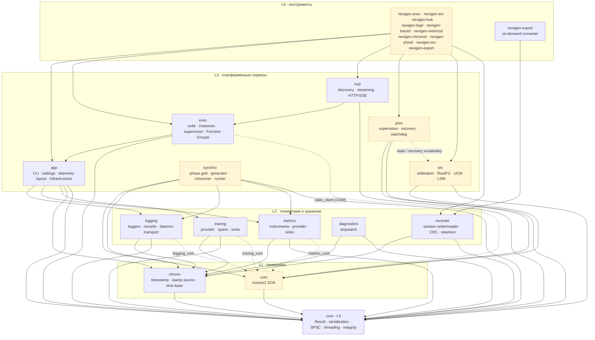

Правила, которые проверяет граф включений:

- `core` зависит только от стандартной библиотеки и `nlohmann/json`;
  `chrono` и `com` — только от `core`; телеметрия — от `core`/`chrono`.
- `recorder` зависит только от `core`/`chrono` и не линкует COM, media, MCAP
  или FFmpeg; `nexigen-export` — отдельная цель поверх `recorder`.
- `app` — единственный владелец подсистем телеметрии; `exec` использует
  `app`, но не тянет `com` в незагеймленное ядро.
- `hub` зависит от `exec` только ради типов раскладки запусков; он ничего не
  запускает и не изменяет.
- `phm` и `sm` работают поверх `com`; их связь с `exec` идёт через
  сообщения, а не через линковку.
- `synchro` — прикладной слой поверх `com`: он зависит от транспорта,
  `chrono`, `logging` и `metrics`, но сам `com` о телеметрии не знает.
  Модуль целиком исчезает при `NEXIGEN_ENABLE_COM=OFF`.

Осознанные исключения, все — внутри `detail/` и не часть публичного
контракта:

- `metrics/detail/metric_http_server.hpp` использует
  `hub/detail/http_parse.hpp`, чтобы не дублировать HTTP-парсер;
- `tracing/detail/trace_daemon_session.hpp` включает типы `exec` и `sm` для
  состояния trace-демона;
- заголовки `phm` включают словари `sm` (`group_state_payload`,
  `recovery_notification`), потому что PHM и SM обмениваются этими
  сообщениями.

## 4. Модули

### 4.1 `core` — базовые примитивы

**Ответственность.** Фундамент, на котором стоят все остальные модули:
модель ошибок, сериализация, словари перечислений, примитивы конкурентности,
управление потоками, общие cold-path утилиты и криптографические хеши.

**Ключевые типы.**

- `Result<T, E = ErrorCode>` и `Status` над `std::expected`; девять кодов:
  `Ok`, `BufferFull`, `BufferEmpty`, `InvalidArgument`, `SystemError`,
  `NotInitialized`, `RateLimited`, `Conflict`, `ResourceExhausted`.
- `serialization_mandate`, `EnumTraits`, `FixedWriter` — единый контракт
  `to_string`/`to_json`/`from_json`/`std::formatter`.
- `SpscRingBuffer<T, Capacity>` — wait-free очередь с одной записью и одним
  чтением, индексы на отдельных cache line.
- `ShardPool` (`shard_pool`) — пул per-thread shard'ов для многопоточных
  производителей.
- `thread_management`: `CpuSet` до 1024 CPU, `ThreadSpec` (имя, политика
  Other/FIFO/RR, приоритет, required/best-effort), `ThreadApplyReport`,
  `apply_thread_spec_self`; `worker_thread` и `worker_tuning` задают
  поведение фоновых потребителей.
- `sink_pack::Fanout`, `sink_io`, `settings_io`/`settings_paths`/
  `settings_source`/`settings_diagnostic` — общая инфраструктура sinks и
  настроек.
- `integrity`: CRC-32C, CRC-64/XZ, SHA-256, сравнение дайджестов за
  постоянное время, `read_verified(path, sha256)`.

**Горячий/холодный путь.** SPSC-очередь и форматирование enum'ов — hot path;
парсинг настроек, JSON и файловые операции — cold path.

**Зависимости.** Только стандартная библиотека и `nlohmann/json`.

**Capabilities (11):** `affinity`, `integrity`, `log-level`, `result`,
`serialization`, `settings-vocabulary`, `sink-plumbing`, `spsc-ring-buffer`,
`thread-management`, `worker-thread`, `worker-tuning`.

### 4.2 `chrono` — время и калиброванный TSC

**Ответственность.** Монотонное время, гражданское время и UTC, калибровка
TSC, эталонные часы процесса, периодические снимки смещения UTC и контроль
пересинхронизации системных часов.

**Ключевые типы.**

- `Timestamp` — наносекунды монотонного времени; `CivilTime` и
  `utc_offset` — форматирование и преобразование монотонного штампа в UTC по
  снятому смещению.
- `TimeDomainClass` (`system_clock`, `cycle_counter`, `device_clock`) и
  `TimeDomain` (`monotonic_raw`, `monotonic`, `tai`, `realtime`,
  `host_counter`; аппаратные домены — `device_domain_base + index`) —
  двухуровневый словарь доменов. `clock_domain<T>` заменён на
  `time_domain<T>`; `ClockId` и `DomainKind` удалены.
- `StampSource` — hot-path источник штампа: `__rdtsc()` плюс
  зафиксированная при калибровке пара `(tsc_anchor, mono_anchor)` и
  fixed-point множитель; периодическая перекалибровка, монотонный clamp и
  безопасный откат на `Timestamp::now()` при ошибке или на не-x86.
- `Provider<MaxSources>` — «беспоточный» авторитет времени: выдаёт stamper'ы
  производителям, снимает UTC-смещение на холодном пути и доставляет
  снимки в sink по триггеру. Банк источников фиксирован; исчерпание —
  `ResourceExhausted`.
- `Worker` — опциональная демон-обёртка для периодических снимков.
- `TimeBaseBlock` / `DomainCoefficient` — опубликованная таблица доменов:
  хаб `CLOCK_MONOTONIC_RAW` (`monotonic_raw`, identity), системные строки
  `monotonic`/`tai`/`realtime`, TSC (`host_counter`) и аппаратные таймеры,
  каждая с прямыми и обратными Q32-коэффициентами, неопределённостью,
  статусом блокировки, эпохой и интервалами валидности в обеих шкалах.
  Строка — 128 байт; блок — 5120 байт: заголовок, 32 строки, встроенный
  `TimeSnapshot` (896 байт). Блок читается через seqlock без блокировки
  писателя. Транспорт (`TimeBaseSegment`, seqlock) живёт в `chrono::detail`,
  а не в `core`: он типизирован `TimeBaseBlock`, и перенос создал бы обратную
  зависимость `core → chrono`. Это уточнение design D-B.

  Раскладка блока:

  | Смещение | Размер | Поле |
  |---:|---:|---|
  | 0 | 24 | `magic`/`version`/`capacity`/`domain_count` |
  | 24 | 40 | `generation` (24) и `status`/флаги |
  | 64 | 64 | `heartbeat_ns` (отдельная cache line) |
  | 128 | 4096 | 32 × `DomainCoefficient` (128 байт) |
  | 4224 | 896 | `last_snapshot` (`TimeSnapshot`) |

  `TimeSnapshot` публикуется на 1 Гц и содержит поколение карт, boot token,
  `sync_mode`, `ServiceFlags`, системные инстанты, смещения TAI/UTC и
  epoch/value/lock каждого домена; таблицу коэффициентов он не дублирует.
- `TimeBaseEstimator` / `TimeBasePublisher` — оценка карты аппаратного домена
  по парам «тики ↔ хаб» (min-residual) и цикл публикации 10 Гц с историей
  только по изменениям, явными gap'ами, четырьмя системными строками и
  снимком 1 Гц. `DeviceAccessMode` задаёт способ получения пары:
  `phc_cross_timestamp` (`PTP_SYS_OFFSET_PRECISE`), `register_pair`
  (D1–D3 latch под sequence/CRC) или `manual_pair` (счётчик и
  `CLOCK_MONOTONIC_RAW` читаются программно, окно чтения становится
  неопределённостью). У каждого объявленного домена свой backend, оценщик,
  эпоха, строка и история; отсутствующий объявленный домен даёт `Degraded`.
- `nexigen-chronod` — обязательный демон: формирует единую монотонную шкалу,
  публикует блок в POSIX shared memory, ведёт `chrono.jsonl` и сообщает
  статус `not_ready/ready/degraded/lost`. Демон владеет единственным
  `chrono::Provider`, снимает им UTC-смещение и передаёт его в
  `TimeBasePublisher`; приложения провайдера не создают. Собирается на
  `chrono` напрямую, без `app::Infrastructure`, и работает при
  `NEXIGEN_ENABLE_COM=OFF`.

  Режимы синхронизации: `Standalone` — мастер локальный осциллятор/RTC;
  `PtpSynced` — внешний IEEE 1588 GM через PHC сетевой карты (`ptp4l` и
  `phc2sys` остаются внешними службами, демон их не запускает и не ищет
  процессы); `Holdover` — lock потерян, используется последняя модель дрейфа
  до истечения окна. Политика (`sync_mode` в конфигурации) задаёт ожидание:
  `Standalone`/`Holdover` публикуются как есть, а `PtpSynced` выводится на
  каждом интервале из состояния `CLOCK_TAI` — дисциплинированный TAI даёт
  `PtpSynced`, потеря — `Holdover` на `holdover_window_ns`, затем `Standalone`. `ServiceFlags` отражают наблюдаемое состояние
  (`phc_present`, `tai_available/synchronized`, `host_counter_*`,
  `ptp4l_required`/`phc2sys_required`, `ptp_stack_ready`, `step_detected`,
  `slew_active`, `rt_sched_applied`, `mlock_applied`,
  `declared_domains_complete`), а не наличие процессов.

  Исполнение: `core::ThreadSpec` (`SCHED_FIFO`, опциональная affinity),
  best-effort `mlockall(MCL_CURRENT|MCL_FUTURE)` и абсолютные дедлайны
  `clock_nanosleep(CLOCK_MONOTONIC, TIMER_ABSTIME)`; обязательный отказ
  атрибута останавливает старт, а `rt_sched_applied`/`mlock_applied` берутся из
  фактического отчёта применения (`DaemonRuntimeReport`), не выставляются
  безусловно. Пороги `TimeSyncMonitor` задаются в конфигурации (`time_sync`).

  Аппаратные домены: `phc_cross_timestamp` читает `PTP_SYS_OFFSET_PRECISE`;
  `register_pair` проходит контракт D1–D3 (двойное чтение `pair_sequence`,
  проверка CRC-32C по D1+D2, отбрасывание torn/stale пар) — при `simulate: true`
  демон поднимает simulated-устройство; `manual_pair` читает счётчик и
  `CLOCK_MONOTONIC_RAW` программно и публикует окно чтения как неопределённость.
  Каждый домен имеет свой backend, оценщик, эпоху, строку и историю.

  Запись сессии: при заданном `record_session_path` демон создаёт
  `recorder::SessionWriter` и через `TimeBaseSessionBridge` пишет по одному
  `TimeBase` на поколение (потеря базы — явный gap) и `TimeSnapshot` на каждый
  новый 1 Гц снимок.
- Sinks: `ConsoleSink`, `JsonFileSink`, `NullSink`, `CompositeSink`;
  `settings` и `snapshot` описывают загрузку конфигурации и сохранение
  смещения.
- `TimeSyncMonitor` сравнивает `CLOCK_REALTIME − CLOCK_MONOTONIC_RAW` и
  классифицирует переходы как `Ok`, `Stepped`, `GoingBackwards`,
  `RateExceeded`; по умолчанию порог шага 1 мс, скорость 500 ppm, окно
  100 мс. Демон вызывает его на каждом 10 Гц сэмпле и переносит вердикт в
  `step_detected`/`slew_active` и lock-состояние строки `realtime`.
  Fixed-point 2-state Kalman (offset, drift, Q12) сглаживает смещения
  `MONOTONIC`/`TAI`/`REALTIME` и даёт неопределённость UTC.

**Зависимости.** `core`.

**Capabilities (11):** `chrono-settings`, `chrono-sink`, `chrono-snapshot`,
`provider`, `stamp-source`, `time-base`, `time-domain`, `time-format`, `timestamp`,
`time-sync`, `worker`.

### 4.3 `com` — межпроцессный обмен (gate)

**Ответственность.** Тонкая объектная обёртка над iceoryx2, которая скрывает
`iox2::` от прикладного кода и даёт zero-copy паттерны AUTOSAR-подобной SOA.

**Ключевые типы.**

- `Node` — участие процесса в коммуникационной фабрике.
- `Publisher<T>`/`Subscriber<T>` — публикация и подписка без копирования;
  `Sample<T>`/`SampleMut<T>` — read-only и loaned-представления слота.
- `Client<Req, Resp>`/`Server<Req, Resp>` — request/response;
  `PendingResponse` — отложенный ответ.
- `Event`/`EventId` — уведомления; `Field<T>` — последнее опубликованное
  значение; `WaitSet` — мультиплексирование ожиданий в ядре с callback
  progression и RAII-гардами вложений.
- `ServiceManifest`, `ServiceName` — архитектурные параметры сервисов
  (глубина истории, число подписчиков, QoS); размеры payload выводятся из
  типа на этапе компиляции.
- `com/e2e` — E2E-защита: `E2eHeader` (16 байт), профили `None`, `P04`,
  `P05`, `P06`, `P07`, обёртки `E2ePublisher`, `E2eSubscriber`, `E2eClient`,
  `E2eServer`, счётчики и `max_delta_counter`.
- `com::Error` — собственная модель ошибок без утечки типов iceoryx2.

**Особенности.** Модуль собирается только при `NEXIGEN_ENABLE_COM=ON`.
Ради cold-path механизма имён типов iceoryx2 модуль локально включает RTTI,
хотя остальной проект собирается с `-fno-rtti`.

**Зависимости.** `core`, `iceoryx2-cxx`.

**Capabilities (7):** `e2e`, `event-system`, `field`, `publish-subscribe`,
`request-response`, `service-management`, `waitset`.

### 4.3a `com/event-system` — событийные каналы

`EventChannel<T>` — прикладная фабрика `producer()`/`consumer()` поверх
`com::Publisher`/`Subscriber`, `EventNotifier`/`EventListener` и `WaitSet`.
Создание идёт только через `EventChannel<T>::create(node, name, config)`,
который валидирует `ChannelConfig` до открытия сервисов.

`EventHeader` (64 B) несёт transport sequence, каноническое время события и
его домен, producer epoch, host ingest time и опциональные FPGA-поля
(`hardware_sequence`, `hardware_timestamp_ns`, `hardware_event_code`).
`EventProducer<T>` назначает sequence только после успешной отправки,
возвращает `Notified`/`NotifyFailed` и умеет повторить wake без повторной
публикации. `EventConsumer<T>` отслеживает потери по transport sequence:
первый sample задаёт baseline, gap даёт точный `lost_count`, duplicate
отбрасывается, sequence reset и смена epoch классифицируются отдельно.
`EventConsumerSet<MaxConsumers>` мультиплексирует до 16 consumer'ов в одном
потоке, поддерживает timeout и `wake_up()` для штатной остановки.

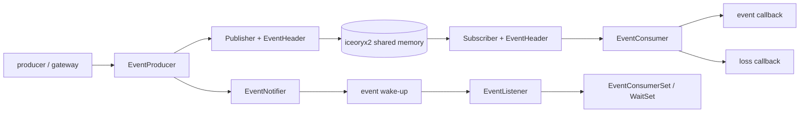

Подробности: [com-event-system.md](com-event-system.md).

### 4.3b `synchro` — фазовая синхронизация (gate)

**Ответственность.** Прикладной слой над `com/event-system`: публикует
события по абсолютной фазовой сетке и превращает поток этих событий в
проверяемую временную опору для потребителей. Модуль решает ровно одну
задачу — «какая фаза сейчас и насколько мы от неё отклонились», не подменяя
собой транспорт и не добавляя собственный брокер.

**Ключевые типы.**

- `SyncPayload` — 32-байтовый trivially-copyable payload: номер цикла, индекс
  и общее число фаз, исходный дедлайн и период цикла. Передаётся zero-copy.
- `SyncSchedule` — арифметика сетки: `T(c, p) = T_start + c·Tc + ⌊p·Tc/N⌋`,
  `classify_overrun` для пропуска устаревших слотов и `resolve_start` для
  политик `NextCycle`/`AtTarget` (включая `Reject` и
  `RealignToNextCycle`).
- `SyncGenerator<Logger>` — один `EventProducer<SyncPayload>` и один worker:
  гибридное ожидание `ppoll` + финальный спин до дедлайна
  (`CLOCK_MONOTONIC_RAW`), публикация с исходным `scheduled_time_ns` в
  payload и фактическим временем в заголовке, счётчики перегрузок и джиттера.
- `SyncConsumer<Logger>` — реализует `com::IEventConsumer`, владеет
  `com::EventConsumer<SyncPayload>` и `SyncTracker`. Считает IPC- и
  end-to-end-задержки, классифицирует опоздания (`DropAndWarn` /
  `DeliverWithFlag`), ведёт watchdog (`initial_sync_timeout_ns`,
  `sync_loss_timeout_ns`) и вызывает обработчики фаз.
- `SyncRunner<Logger>` — ровно один consumer и один
  `EventConsumerSet<16>`: `run_once()` возвращает `com::WaitOutcome`, `run()`
  крутится до `stop_token`, `wake_up()` будит ожидание при остановке.
  Несколько каналов обслуживаются несколькими runner'ами.
- `SyncError`/`SyncResult` — собственная модель ошибок с `SyncErrorKind`,
  транспортом `com::Error` и `core::ErrorCode`.

**Непрерывность.** Абсолютная позиция фазы — `cycle_number * phases_total +
phase_index`. `transport gap` объясняет часть скачка, остаток относится к
перегрузке генератора (`generator_skips`); смена epoch, изменение
`phases_total`, обратный ход цикла и неожиданный reset дают `resync` без
ложного пропуска. Это позволяет отличить потерю транспорта от пропуска
дедлайна, не смешивая два разных класса отказов.

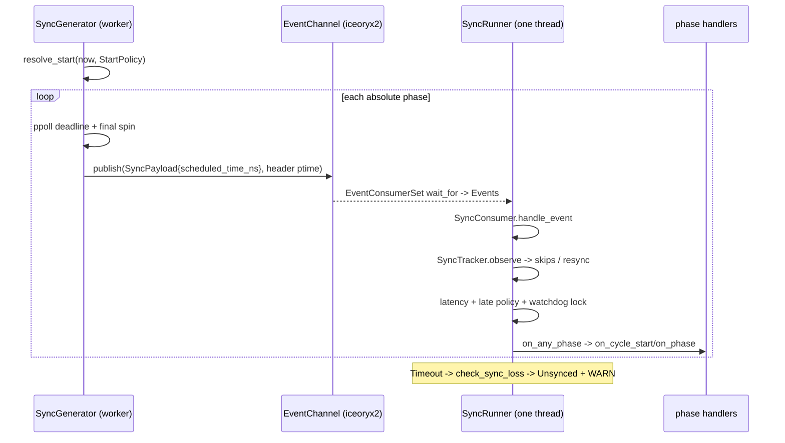

**Особенности.** Модуль собирается только при `NEXIGEN_ENABLE_COM=ON`.
Каждый канал требует собственного `metrics::Meter`: имена инструментов
фиксированы, дубликат регистрации — ошибка создания. Все инструменты
`MultiThreaded`, горячий путь не выделяет память и не берёт блокировки.
Жёсткий предел v1 — 16 потребителей в одном наборе и минимальный период
фазы 1 мс; масштабирование идёт каналами и runner'ами.

**Зависимости.** `com`, `chrono`, `logging`, `metrics`, `core`.

**Capabilities (3):** `consumer`, `generator`, `protocol`.

### 4.4 `logging` — асинхронные логи

**Ответственность.** Запись логов без блокировок на горячем пути:
производитель кладёт отложенный формат в свой shard, фоновый потребитель
форматирует и отдаёт запись в sink.

**Ключевые типы.**

- Концепт логгера и семейство: `ConsoleLogger`, `FileLogger`,
  `CompositeLogger`, `NullLogger`, `Iceoryx2Logger`.
- `LogRecord` — payload между производителем и потребителем с отложенным
  набором аргументов; `format_with_location` добавляет место вызова.
- `LoggerOptions` — единая конфигурация инициализации (ёмкости, пороги,
  `ThreadSpec`, overflow policy); после старта читаются только relaxed
  atomics.
- Многопроизводительный режим: до `MaxThreads` (по умолчанию 32) потоков,
  у каждого свой SPSC-shard, единственный потребитель — внутренний worker.
- Anti-spam: квоты, окна throttle, `SpamProtectionConfig`,
  `ThrottleConfig`; статистика потерь — `DroppedStats`.
- Ротация: `RotationConfig`, `RotationSchedule`, размерные сегменты
  `app.jsonl → app.1.jsonl → …` и почасовые директории.
- `LogFrame`/`LogDaemonConfig` — фиксированный кадр и конфигурация
  центрального демона `nexigen-logd`.
- Форма лог-сервиса: `log_service_capacity.hpp` задаёт 4 подписчика,
  64 паблишера, 64 узла, глубину 16 384 и safe overflow, а
  `log_service_options()` отдаёт их как `com::PublishSubscribeOptions`.
  Первый участник фиксирует форму; демон, рекордер, вьюер и каждый
  `Iceoryx2Logger` обязаны использовать один и тот же набор.
- `logging_settings` — загрузка global/local JSON и `NEXIGEN_LOG_*`
  окружения с best-effort диагностикой.

**Зависимости.** `core`, `chrono`; `Iceoryx2Logger` доступен только через
интерфейсную цель `nexigen_logging_com`.

**Capabilities (14):** `composite-logger`, `console-logger`, `file-logger`,
`format-api`, `iceoryx2-logger`, `log-daemon`, `logger-concept`,
`logger-options`, `logging-settings`, `log-level`, `log-record`,
`multi-producer`, `null-logger`, `spam-protection`.

### 4.5 `metrics` — метрики

**Ответственность.** Инструменты измерения, фоновый сбор и доставка
снимков в sinks без выделения памяти и блокировок на пути записи.

**Ключевые типы.**

- `Counter`, `Gauge`, `StateGauge`.
- `ExplicitHistogram`, `ExponentialHistogram`, `DescriptiveStatistics`,
  снимки `HistogramSnapshot`, `StatisticsSnapshot`.
- `Meter` — фабрика инструментов и владелец идентичности метрики.
- `MetricProvider` — реестр, фабричный корень и фоновый harvester: один
  выровненный блок памяти на арены, таблицы слотов и буфер сбора; поток
  применяет `ThreadSpec` до первой партии.
- Sinks: `ConsoleMetricSink`, `JsonFileMetricSink`, `Iceoryx2MetricSink`,
  `NullMetricSink`, `CompositeMetricSink`; тип-стёртая привязка через
  указатели на функции, без виртуальности и RTTI.
- `MetricFrame` — фиксированный кросс-процессный кадр; `MetricDaemonConfig`
  и `metrics_settings` — конфигурация демона и загрузчик настроек.
- Cold-path рендеринг Prometheus и запись JSONL-истории.

**Зависимости.** `core`, `chrono`; iceoryx2-sink — через
`nexigen_metrics_com`.

**Capabilities (14):** `counter-gauge`, `descriptive-statistics`,
`examples`, `explicit-histogram`, `exponential-histogram`,
`iceoryx2-metric-sink`, `metric-concepts`, `metric-provider`,
`metrics-daemon`, `metric-sinks`, `metrics-settings`, `policy-enums`,
`snapshot-format`, `state-gauge`.

### 4.6 `tracing` — трассировка

**Ответственность.** RAII-спаны, распространение контекста между потоками и
процессами, доставка записей в sinks и аварийные снимки trace-демона.

**Ключевые типы.**

- `TracerProvider<ShardCapacity = 1024, MaxThreads = 32>` — владеет всем
  объёмом памяти трассировки: per-thread SPSC-shards, отдельный `StampSource`
  на слот, счётчики потерь и пул tracer'ов; объект порядка 10 MiB, поэтому
  живёт в статической памяти или на куче.
- `Tracer`, `ScopedSpan` — старт/завершение спана; `SpanContext`, `TraceId`,
  `SpanId`, `TraceHeader` — распространение контекста.
- `SpanRecord`, `SpanFrame`, `SpanKind`, `SpanStatus`, `SamplingDecision`.
- Sinks: `ConsoleTraceSink`, `JsonFileTraceSink`, `ChromeTraceSink`
  (Perfetto-совместимый), `Iceoryx2TraceSink`, `NullTraceSink`,
  `CompositeTraceSink`; `RotationPolicy` управляет ротацией файлов.
- `TraceDaemonConfig` и `trace_daemon_session` — RAM-ring последних секунд и
  версионированный снимок по аварийному событию PHM.

**Зависимости.** `core`, `chrono`; iceoryx2-sink — через
`nexigen_tracing_com`.

**Capabilities (12):** `examples`, `iceoryx2-trace-sink`, `record-format`,
`scoped-span`, `span-context`, `span-enums`, `trace-daemon`,
`trace-propagation`, `tracer-concepts`, `tracer-provider`, `trace-sinks`,
`tracing-settings`.

### 4.7 `diagnostics` — измерения интервалов

**Ответственность.** Дешёвое измерение длительности операций и бюджетов
реального времени.

**Ключевые типы.** `Stopwatch` — один cache line, trivially copyable, без
атомиков, блокировок и кучи; источник штампа — `Timestamp::now()` или
внедрённый `StampSource`. `ScopedStopwatch` — RAII-гард с `OutRefSink` для
записи результата. `StopwatchState`, `LapSnapshot` — состояние и снимки.

**Зависимости.** `core`, `chrono`.

**Capabilities (4):** `examples`, `scoped-stopwatch`, `stopwatch`,
`stopwatch-state`.

### 4.8 `app` — прикладной слой

**Ответственность.** Запуск приложения: разбор командной строки, слияние
настроек, телеметрическая раскладка и владение подсистемами телеметрии.

**Ключевые типы.**

- `parse_command_line` (`command_line`), `CommandLineOptions`,
  `CommandLineError`, `CommandLineDiagnostic` — холодный парсер аргументов
  (`-h/--help` короткозамыкает разбор).
- `app::Settings` (`app_settings`), `AppSettingsPaths` — слияние
  global/local JSON.
- `RunIdentity`, `telemetry_layout` (load/validate/resolve), `TelemetryPaths` —
  идентичность запуска из `NEXIGEN_*` окружения и пути трёх JSONL-потоков
  (metrics, traces, chrono).
- `Infrastructure<Policy>` — heap-only сервис, создаваемый только через
  `make_infrastructure<Policy>()`. Владеет логгером, метриками,
  трассировкой и chrono в безопасном порядке, монопольно владеет
  обработкой `SIGINT`/`SIGTERM`/`SIGHUP` через `signalfd`, выполняет
  `run(tick)`, фиксирует причину остановки и детерминированно освобождает
  ресурсы в обратном порядке. Второй инициализированный экземпляр получает
  `ErrorCode::Conflict`.
- `App<Policy>` — фасад для минимальных приложений: `create` → instruments/ports
  → `run` → `shutdown`; поддерживает `External`/`Embedded` time base, один вход
  и опциональный выход, диагностику объявлений и `SIGPIPE`.

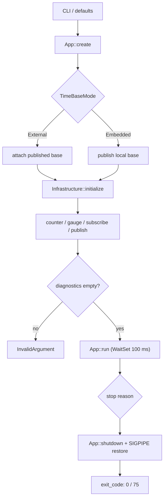

**Порядок и остановка.** Инициализация: time base → логгер → метрики →
трассировка → watcher. Остановка: watcher → финальная запись в лог →
`tracer.quiesce()` → `metrics.quiesce()` → `logger.flush()` →
`logger.quiesce()` → `TimeBaseClock::detach()`. `shutdown()` не уничтожает
провайдеры и sink'и: память освобождает только деструктор
`Infrastructure`, поэтому уже выданные хэндлы остаются memory-safe до конца
`main`. После shutdown запись метрик принимается и не собирается, спаны
отвечают `NotInitialized`, записи лога дропаются, а `meter()`/`tracer_for()`
закрыты. Ошибки quiesce трассировки и метрик логируются, пока логгер ещё
активен.

```mermaid
sequenceDiagram
    autonumber
    participant U as main
    participant I as Infrastructure
    participant C as chrono (time base)
    participant L as logger
    participant M as metrics
    participant T as tracing

    U->>I: initialize(settings)
    I->>C: TimeBaseClock::attach
    I->>L: emplace + start (первым)
    I->>M: provider start
    I->>T: provider start
    U->>I: run(tick)
    U->>I: shutdown()
    I->>L: flush + финальная запись
    I->>T: quiesce (flush -> stop -> seal)
    I->>M: quiesce (stop -> collect -> flush -> seal)
    I->>L: flush + quiesce (последним)
    I->>C: detach
    U->>I: ~Infrastructure
    I->>T: destroy (storage)
    I->>M: destroy (storage)
    I->>L: destroy (storage)
```

**Диагностика.** Все подсистемы сообщают о переходах через общий
`core::DiagnosticBinding` (16 байт, borrowed, null = no-op). Событие несёт
`DiagnosticSource`, `DiagnosticKind` и `ErrorCode`; эмиссия — только холодный
путь и только на переход (`Started`, `Degraded`, `Recovered`, `Quiesced`).
Провайдеры не знают о логгере: приложение подставляет
`app::detail::DiagnosticForwarder<Logger>`. До появления логгера провал attach
time base пишется синхронным `app::detail::BootstrapDiagnostics` в stderr.

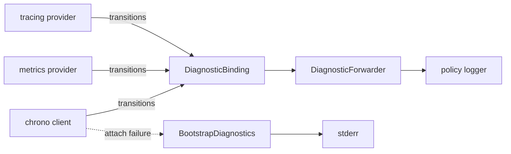

Runtime-пути не читают `CLOCK_REALTIME`: метрики резолвят UTC через
`TimeBaseClock` и несут `utc_resolved`, демон трейсов использует attached
time base, а startup-offset — только как fallback, отчитываясь один раз.

**Зависимости.** `core`, `chrono`, `logging`, `metrics`, `tracing`.

**Capabilities (4):** `application`, `command-line`, `settings`,
`telemetry-layout`.

### 4.9 `exec` — исполнение и супервизия

**Ответственность.** Управление жизненным циклом suite и приложений:
манифесты, запуск, readiness, остановка, рестарты, Function Groups и
артефакты запуска.

**Ключевые типы.**

- `ExecutionManager` — stateless-контроль одного instance через его
  директорию: `start` создаёт layout, генерирует настройки, делает
  `fork`/`setsid`/`execvp` и пишет `resource.json`; `stop`/`status`
  работают только с диском.
- `SuiteManifest`, `AppSpec`, `FunctionGroupConfig` — suite-манифест,
  приложения, Function Groups и `initial_state`.
- `start_suite`/`stop_suite` (`suite_control`), `ChildProcess`,
  `ExecutionStateTracker` — detached-супервизор, состояние каждого ребёнка и
  подтверждение готовности.
- Модель процессов: `ProcessType` (`daemon`/`oneshot`), `ProcessState`,
  `AppState`, `ApplicationStateReporter`, `SuiteState`, `SuiteStatus`,
  `UnrecoverableState`.
- Раскладка и артефакты: `suite_paths`, `instance_layout`,
  `instance_settings`, `instance_file_io`, `SuiteMetadata`,
  `SuiteAppMetadata`, `SuiteExit`, `ResourceMetadata`, `ExitMetadata`,
  `run`-лог.
- `ManifestAccessor` — определение JSON/ARXML и единый путь
  `from_json` + `validate_suite_manifest`; `MachineManifest` —
  кросс-проверка ссылок на процессы машины (`nexigen-exec --machine`).
- `ControlHost` — COM-свободная граница супервизора; конкретная
  COM-реализация живёт в `nexigen_exec_control`.
- `StateClient` — приёмная сторона `SetState`; `FunctionGroupRegistry`,
  `StateCommand`/`StateAck`/`StateResult`, `state_dependent_startup_config`,
  `request_id` и access control по `function_group_port_mapping`.
- Platform controls: `ResourceGroupConfig` (RLIMIT_AS, cgroup v2
  CPU/memory, CPU set, working folder), `cgroup_budget`,
  `sha256_file`/`executable_digest`, `SettingsDigest`,
  `TrustedPlatformConfig`, `uid`/`gid` и сброс `CAP_SYS_NICE`.
- `DeterministicClient` — фиксированный такт, seeded splitmix64 и работа
  без выделений для одного execution-потока.
- `root_function_group`/`root_state_query` — словарь имён и состояний RootFG
  и payload результата начального перехода.

**Границы.** `nexigen_exec` не содержит COM-символов и собирается при
выключенном gate. `state_client.cpp`, `control_host_com.cpp` и
`recovery_handler.cpp` вынесены в отдельные цели, подключаемые только к
инструментам при `NEXIGEN_ENABLE_COM=ON`.

**Зависимости.** `core`, `app`; COM-части — `com`.

**Capabilities (18):** `application-state`, `app-suite`,
`deterministic-execution`, `function-group-state`, `instance-lifecycle`,
`logging`, `machine-manifest`, `manifest-accessor`,
`process-lifecycle-events`, `process-supervision`, `process-types`,
`resource-groups`, `root-function-group`, `state-client`,
`state-client-access-control`, `state-request-ids`, `trusted-executable`,
`update-state`.

### 4.10 `hub` — наблюдаемость

**Ответственность.** Read-only обзор завершённых и текущих запусков:
обнаружение директорий, потоковая доставка телеметрии и HTTP/SSE API.

**Ключевые типы.**

- `Discovery` — явные run-root'ы, канонизация путей, inotify и
  согласование дерева `run → suite → app → instance/attempt`.
- `StreamManager` — ограниченные tailer'ы, replay-ring по числу записей и
  байтам, `GapMarker` при переполнении, подписчики.
- `HttpServer` — один epoll-цикл (listener, eventfd, inotify, клиенты,
  таймеры, polling потоков), HTTP/1.1 + SSE, встроенный web UI, только
  `GET`; лимиты запроса и клиентов, `400`/`404`/`405`.
- DTO: `HubTree`, `HubRun`, `HubSuite`, `HubApp`, `HubInstance`,
  `HubAttempt`, `HubStream`, `StreamRecord`, `StreamKind`.

**Зависимости.** `core`, `exec` (типы раскладки).

**Capabilities (4):** `discovery`, `http-api`, `streaming`, `web-ui`.

### 4.11 `phm` — здоровье и восстановление (gate)

**Ответственность.** Замкнутый контур «обнаружение → реакция»: супервизия
процессов, проверка identity, запись отказов, watchdog и восстановление
через EM.

**Ключевые типы.**

- `PhmManifest` — декларативное описание наблюдаемых сущностей.
- `Supervisor` — по одной headless-машине на процесс: `Alive` (счётчики за
  окно и допуски), `Logical` (граф разрешённых переходов и fork/join),
  `Deadline` (пары source→target), толерантность `Ok → Failed → Expired`.
  Все горячие пути O(1) по размеру манифеста, без выделений и блокировок.
- `CheckpointEmitter`, `HealthChannel`, `SupervisedEntity` — клиентская
  сторона: checkpoints, отчёты о здоровье, чтение состояния Function Group,
  периодическая публикация claim.
- `ClaimPublisher`, `ClaimRegistry`, `ClaimVerdict`,
  `SecurityEvent` — проверка `{name, pid, uid}` через `/proc` и события
  безопасности при чужом или неизвестном claim.
- `RecoveryClient`, `RecoveryRequest`, `RecoveryResponse`, `RecoveryAction` —
  `RestartProcess` (через EM, без расхода retry-бюджета) и локальный
  `TriggerWatchdogReset`.
- `FaultStorage`, `FaultKind`, `verify_fault_log`/`FaultLogReport` —
  неблокирующая запись отказов с монотонным номером и CRC-32C; проверка
  целостности журнала.
- `Watchdog`, `WatchdogDevice`, `PosixWatchdogDevice`, `WatchdogState`,
  `WatchdogConfig` — `/dev/watchdog`, период кормления не более половины
  таймаута, отключён по умолчанию, magic close при остановке.
- `LogicalFork`, `EmLifecycleState`, `SupervisionStatus` — логические
  fork/join-регионы и приостановка супервизии на время штатной остановки.

**Зависимости.** `com`; словари `sm` — только на уровне заголовков.

**Capabilities (7):** `health-channel`, `identity`, `manifest`, `recovery`,
`supervised-entity`, `supervision`, `watchdog`.

### 4.12 `sm` — управление состояниями (gate)

**Ответственность.** Центральный арбитр Function Groups: проверка переходов,
приоритеты запросов, публикация состояний, аудит, RootFG, лёгкие
декларативные машины и координация обновлений UCM.

**Ключевые типы.**

- `SmManifest`, `StateManager` — по одной headless-машине на группу,
  проверка перехода по графу и арбитраж по приоритету текущего держателя;
  startup/shutdown — явные шаги, а не рёбра графа. Прикладная группа не
  покидает off-like состояние, пока `RootFG` не достиг `Run`.
- `GroupStatePayload`, `StatePublication` — публикация состояния как
  `Field`; `TriggerRequest`/`TriggerResponse` — входящие запросы;
  `TransitionPreparation` — handshake подготовки.
- `TransitionResult`, `TransitionRecord`, `TransitionAudit` — результат,
  запись и неблокирующий журнал аудита; `SmMetrics` — метрики арбитража.
- `LightweightStateMachine`, `LsmRuntime` — декларативные таблицы
  переходов, действий и recovery для группы.
- `RootFG` (enum), `RootLifecycleClient` — словарь `Off`/`Startup`/`Verify`/
  `Run`/`Shutdown`/`Restart` и клиент начального перехода EM.
- `UpdateRequest`/`UpdateResponse`, `UpdateCoordinator` — `Start`/`Complete`/
  `Cancel` обновления: блокировка группы, состояние `Update`, отказ
  `RejectedByUpdate`, единственный активный update.
- `RecoveryHandler`, `RecoveryNotification` — обработка восстановления от
  PHM.

**Зависимости.** `com`.

**Capabilities (9):** `ipc`, `lifecycle`, `lightweight-state-machine`,
`lsm-runtime`, `manifest`, `recovery-handler`, `state-machine`,
`telemetry`, `ucm-coordination`.

### 4.13 `recorder` — сырые сессии и конвертер

`nexigen_recorder` — self-contained хранилище сессий: `session.json` плюс
триплеты `.nxrec` (append-only записи), `.nxidx` (разреженный индекс) и
`.nxvid` (кадры с выравниванием 4 KiB). Модуль не зависит от COM, media,
MCAP или FFmpeg; всё, что нужно для чтения, лежит внутри сессии.

- **Горячий путь.** Один writer владеет порядком и индексом; все буферы
  выделены в `create()`, `append()` не аллоцирует и не блокируется.
  Производители передают записи через SPSC `RecordShard`, переполнение
  превращается в `GapMarker` (`IoBackpressure`).
- **Формат.** Каждая запись покрыта CRC-32C; метаданные — `RecordHeader`
  (48 B), `VideoFrameRef` (64 B), `VideoStreamConfig` (1056 B),
  `SegmentFooter` (64 B). Видео хранится как непрозрачные байты с
  необязательным per-frame CRC; запись не декодирует и не перекодирует
  битстрим.
- **Ротация и восстановление.** Сегмент закрывается по байтам (`.nxrec` +
  `.nxvid`), длительности или числу записей; `circular` удаляет только
  закрытые триплеты, `stop` финализирует и останавливает приём,
  `min_free_bytes` не даёт открыть новый сегмент. Повреждённый хвост
  читается как префикс, отсутствующий `.nxidx` перестраивается.
- **Чтение и конвертация.** `SessionReader` строит инвентарь датасетов,
  фильтрует по каналу и event-time, проверяет CRC и читает видео по
  `VideoFrameRef`. `nexigen-export` — on-demand CLI: `inspect`, `list`,
  `info`, `extract`, `verify`; выходы JSONL, Perfetto, MCAP (опционально)
  и elementary video. MP4/MKV отложены до `nexigen_media`.

**Зависимости.** `core`, `chrono`; MCAP — только в `nexigen-export`.

**Capabilities (3):** `recorder/raw-storage`, `recorder/video-storage`,
`recorder/export`.

Подробности формата и CLI: [recorder.md](recorder.md), раздел 10.

## 5. Взаимодействие компонентов

### 5.1 Карта процессов и каналов

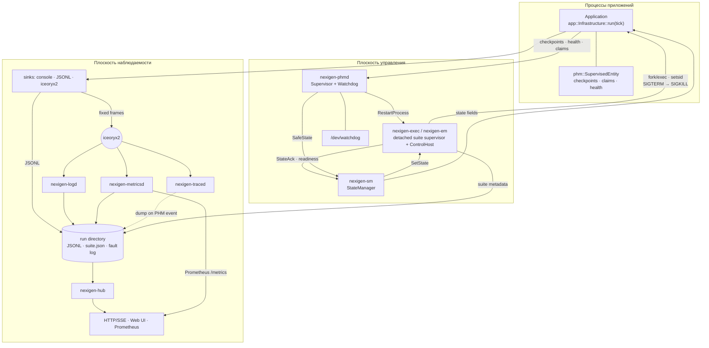

Ключевые потоки:

- **EM → приложение.** `nexigen-exec`/`nexigen-em` поднимают detached
  супервизор, который запускает каждое приложение в новой сессии и группе
  процессов и применяет остановку по таймауту (`SIGTERM` → `SIGKILL`).
- **SM → EM → приложение.** `nexigen-sm` отправляет `SetState` в
  `StateClient`; EM разрешает состояние в набор процессов через
  `FunctionGroupRegistry` и выполняет stop/restart/start через
  `ChildProcess`.
- **Приложение → EM.** Readiness каждого процесса и результаты переходов
  собирает трекер готовности EM через state-каналы
  (`Nexigen/EM/State/*`); SM получает итог перехода.
- **Приложение → PHM.** Checkpoints, отчёты о здоровье и identity claims
  публикуются в `Nexigen/PHM/*`; PHM принимает checkpoints только после
  проверки claim.
- **PHM → EM/SM.** При `Expired` PHM выполняет настроенное правило
  восстановления: `RestartProcess` через `Nexigen/PHM/Recovery` или
  SafeState-команду в SM; watchdog останавливает кормление, если есть
  просроченные сущности.
- **Телеметрия → диск → hub.** Sinks пишут JSONL в run-директорию или
  отправляют кадры в iceoryx2; демоны агрегируют их; `nexigen-hub` читает
  файлы и отдаёт клиентам.

### 5.1a CAN data path

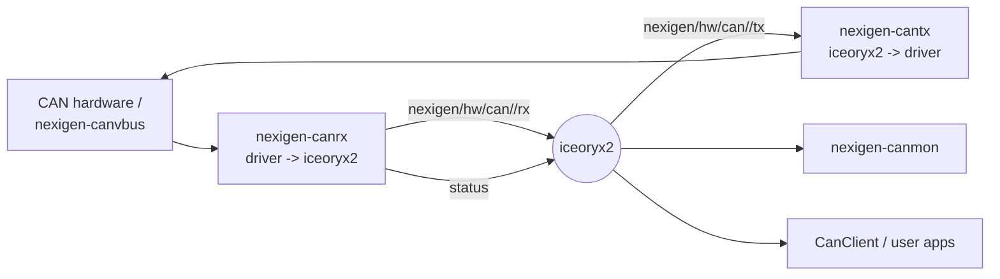

### 5.1b Log viewer data path

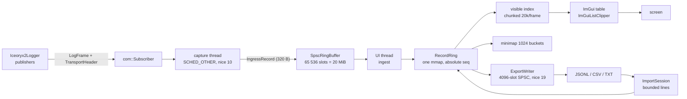

The receive thread is the only producer and the UI thread the only consumer of
the ingress queue; the history ring has a single owner (the UI thread), so the
viewer needs no seqlock or torn-read protocol. Pause freezes the displayed
range while ingest continues, and the banner reports how many displayed records
were overwritten. `nexigen-logview` is read-only for the platform: stopping it
changes no service or on-disk state.

### 5.2 Телеметрический конвейер

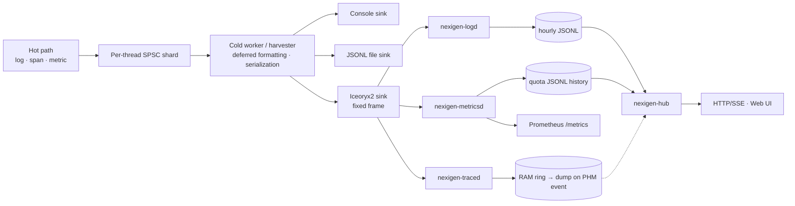

Инварианты конвейера:

- производитель не выделяет память, не форматирует и не блокируется;
- при переполнении ring'а публикуется `GapMarker` с диапазоном потерянных
  последовательностей — потеря видима, а не маскируется;
- каждый модуль телеметрии имеет собственный shard и не блокирует
  соседние;
- JSON-сериализация, разбор имён и файловый ввод-вывод выполняются только
  на холодном пути.

### 5.3 Жизненный цикл suite и Function Groups

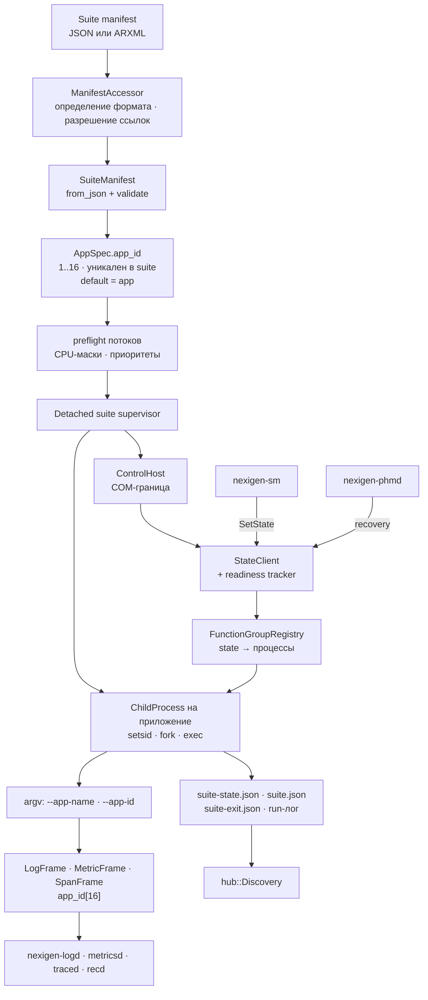

Порядок выполнения:

1. `nexigen-exec start --config` или `nexigen-em --config` загружают
   манифест, проверяют его и при необходимости сверяют с Machine Manifest.
2. Запускается detached-супервизор; при COM-сборке он устанавливает
   `ControlHost` и создаёт `StateClient` с трекером готовности.
3. Супервизор входит в `initial_state` через тот же движок переходов, что
   и любой `SetState`, а не прямым циклом запуска.
4. `daemon`-процессы обязаны сообщить `Run`, `oneshot` — завершиться с
   кодом 0; только после этого переход подтверждается.
5. `stop` останавливает приложения с grace-периодом, затем супервизор
   фиксирует `suite-exit.json` и причину остановки.

### 5.4 Последовательность `SetState`

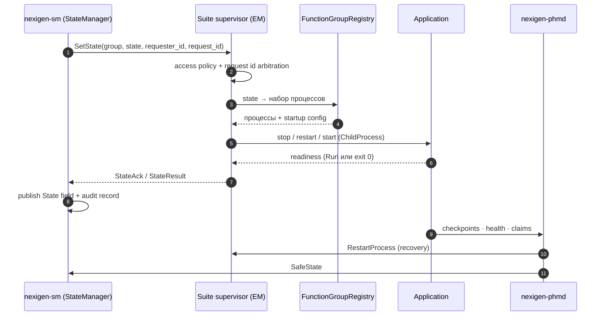

### 5.5 RootFG

`RootFG` — зарезервированная корневая Function Group: брокер сообщений, SM,
PHM, EM и будущий DataRecorder. Манифест может объявить её с фиксированным
набором состояний; `Off` не имеет привязанных процессов, `Run` — целевое
состояние, `Restart` — быстрый перезапуск без прохода через `Off`.

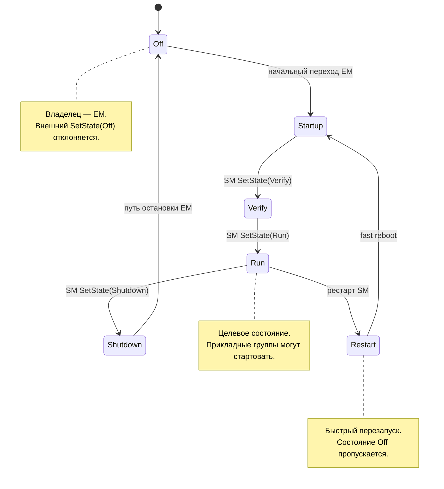

Начальный переход `Off → Startup` выполняет EM через общий движок
переходов и публикует результат в
`Nexigen/EM/InitialRootStateTransitionResult`. SM читает результат, затем
командует `Verify` и `Run`. Пока RootFG не в `Run`, прикладные группы не
покидают off-like состояния. EM также публикует
`Running`/`Terminating`/`Terminated` в `Nexigen/PHM/ExecutionState`, чтобы
PHM приостанавливал супервизию на время штатной остановки.

### 5.6 Запись и конвертация raw-сессии

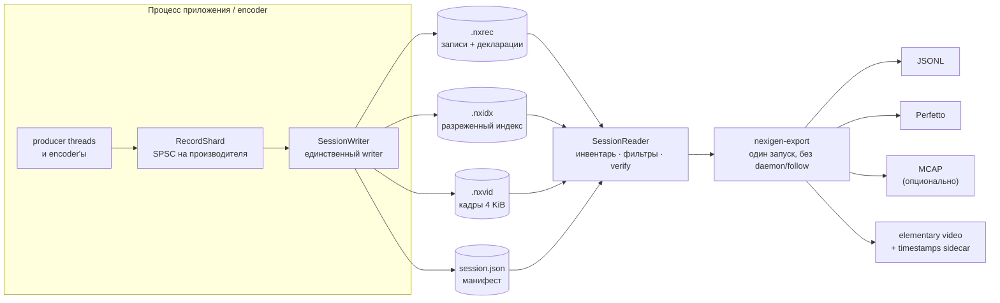

- **Запись.** Несколько producer-потоков пишут каждый в свой `RecordShard`;
  только `SessionWriter` владеет порядком, индексом, ротацией и retention.
  При переполнении shard'а теряется диапазон, но появляется `GapMarker`
  (`IoBackpressure`), поэтому потеря наблюдаема.
- **Файлы.** Writer добавляет декларации схем/каналов до первых записей,
  считает CRC-32C, пишет разреженный `.nxidx`, выравнивает кадры в
  `.nxvid` и периодически атомарно заменяет `session.json`.
- **Чтение.** `SessionReader` открывает либо каталог сессии, либо один
  `.nxrec`; отсутствующий индекс перестраивается, повреждённый хвост
  читается как префикс, `verify` проверяет записи, footer'ы и CRC кадров.
- **Конвертация.** `nexigen-export` — on-demand процесс: он не является
  демоном, не поддерживает `--follow` и завершается после записи выхода.
  MCAP включается отдельной опцией сборки; MP4/MKV отложены до
  `nexigen_media`.

## 6. Инструменты командной строки

| Инструмент | Сборка | Роль |
|---|---|---|
| `nexigen-exec` | всегда | CLI жизненного цикла suite и instance: `start`, `stop`, `status`; при COM — с `ControlHost` |
| `nexigen-hub` | всегда | HTTP/SSE-обсерватория над run-root'ами, встроенный web UI |
| `nexigen-export` | всегда (MCAP опционально) | On-demand конвертер raw-сессий: `inspect`, `list`, `info`, `extract`, `verify`; JSONL, Perfetto, MCAP, elementary video |
| `nexigen-em` | COM | фронтенд Execution Manager: запускает тот же detached-супервизор, что и `nexigen-exec` |
| `nexigen-sm` | COM | State Manager: арбитраж, публикация состояний, TriggerIn, UCM, аудит |
| `nexigen-phmd` | COM | супервизия, recovery, faults, watchdog; `--verify-fault-log` |
| `nexigen-logd` | COM | приём `LogFrame`, форматирование и почасовая JSONL-запись |
| `nexigen-metricsd` | COM | агрегация метрик, Prometheus HTTP, квотируемая JSONL-история |
| `nexigen-traced` | COM | RAM-ring спанов и аварийный снимок по событию PHM |
| `nexigen-logview` | COM + `NEXIGEN_BUILD_LOGVIEW` | интерактивный просмотр живого `LogFrame`-потока: ImGui/GLFW, ограниченная история, фильтры, find, bookmarks, time/delta modes, экспорт/импорт, ECO |

Инструменты при `NEXIGEN_BUILD_TOOLS=ON` собираются вместе с библиотекой;
COM-зависимые инструменты появляются только при включённом gate.

## 7. Сквозные контракты

### Ошибки и сериализация

- Публичные fallible-функции возвращают `Result`/`Status`; исключения и
  RTTI запрещены глобально (кроме cold-path исключения в `com` для
  iceoryx2).
- Каждый публичный тип имеет холодный `to_string()` (член и свободную
  функцию), `to_json`/`from_json` и `std::formatter`; перечисления —
  `constexpr to_string`/`from_string`.
- Тела сериализации живут в скомпилированных единицах `src/*/*_format.cpp`,
  чтобы не раздувать TU потребителей.

### Горячий и холодный путь

| | Горячий путь | Холодный путь |
|---|---|---|
| Память | без выделений | `std::string`, `nlohmann::json`, файлы |
| Синхронизация | wait-free atomics, SPSC | мьютексы control plane |
| Ошибки | предпроверенные `Status` | `Result` с диагностикой |
| Бюджет | наносекунды, latency-гейты | не ограничен |

### Потоки и affinity

`CpuSet` адресует до 1024 CPU; `ThreadSpec` задаёт имя, политику и
приоритет, а также режим применения — required (ошибка откатывает
инициализацию) или best-effort (ошибка видна в `ThreadApplyReport`). Каждый
фоновый worker применяет копию спецификации к себе до старта sink'а.

### Идентичность запуска и телеметрия

`app::load_run_identity` читает `NEXIGEN_RUN_ID`, `NEXIGEN_EXEC_DIR`,
`NEXIGEN_INSTANCE_ID`, `NEXIGEN_INSTANCE_DIR`; `resolve_telemetry_paths`
отображает их в пути metrics/traces/chrono. Контракт не зависит от языка и
используется реализациями на C#, Python и C++.

### Формат JSONL v2 (монотонное время)

Все три файловых потока (логи, метрики, трейсы) несут канонический
монотонный инстант и boot-токен; UTC остаётся производным полем.
Каноническая шкала — `CLOCK_MONOTONIC_RAW`; UTC берётся из опубликованной
базы времени (`TimeBaseClock`), а не из локальных часов писателя.

Порядок и состав полей:

- лог: `timestamp, mono_ns, boot, level, app, thread_id, message`;
- метрики: `timestamp, mono_ns, boot, app, records`;
- трейс: `app, trace_id, span_id, parent_span_id, kind, status, thread_id,
  start, end, start_mono_ns, end_mono_ns, boot, duration_ns, name, file,
  function, line, column, attributes`.

`mono_ns`/`start_mono_ns`/`end_mono_ns` — числа наносекунд канонической
шкалы, `boot` — 16 шестнадцатеричных символов (первые 8 байт
`/proc/sys/kernel/random/boot_id`). `timestamp`/`start`/`end` — строки
`YYYY-MM-DDTHH:MM:SS.nnnnnnnnnZ`. Если опубликованная калибровка не покрывает
инстант, соответствующее поле равно `null`: `mono_ns` и `boot` остаются
достоверными, выдуманный UTC не появляется.

Строка без `mono_ns` (для трейса — без `start_mono_ns`/`end_mono_ns`)
считается legacy-форматом: читатель опирается только на ISO-время.
Неизвестные поля читатели игнорируют, поэтому добавление ключей не ломает
старые парсеры.

`nexigen-logd` пишет тот же набор полей для входящих `LogFrame`, а
`nexigen-metricsd` добавляет `mono_ns`/`boot` к каждому окну истории.
`nexigen-traced` фиксирует boot-токен в заголовке бинарного снимка
(`TraceDumpHeader.boot_token`).


### Безопасность и целостность

- Дайджесты SHA-256 для манифестов, исполняемых файлов и файлов настроек;
  проверка до `fork`/запуска, ошибка — `SecurityError`.
- `trusted_platform` требует абсолютных команд; `require_non_root` и
  `uid`/`gid` выполняют сброс привилегий до `exec`; `CAP_SYS_NICE`
  сбрасывается, если не разрешён явно.
- Identity claims (`{name, pid, uid}`) проверяются через `/proc`; чужой
  claim порождает `SecurityEvent`.
- Access control для `SetState` по парам `(requester, Function Group)`;
  `request_id` отменяет устаревшие переходы.
- E2E-профили защищают обмен от искажения, повторов, потерь, переупорядочения
  и ошибочной доставки.
- `TimeSyncMonitor` обнаруживает шаг, обратный ход и превышение скорости
  системных часов.
- `nexigen-chronod` публикует статус базы времени и историю карт доменов;
  потеря обязательного домена или устаревший heartbeat переводят приложение
  в holdover ≤ 2 с и затем в `time_base_lost`, без самостоятельных ретраев.
- Fault-журнал PHM содержит монотонный номер и CRC-32C; режим
  `--verify-fault-log` различает целые, повреждённые, усечённые и legacy
  записи.

## 8. Спецификации и трассируемость

Спецификации лежат в `openspec/specs/<module>/<capability>/spec.md`; путь
повторяет структуру `include/nexigen/`. Каждая capability содержит
требования (`Requirement`) и проверяемые сценарии (`Scenario`).

- Основной корпус: 129 capability, 929 требований, 2409 сценариев.
- `synchro` вошёл в основной корпус из архивированного change
  `add-synchro-event-sync` (2026-11-18): `synchro/{protocol,generator,consumer}`,
  3 capability, 23 требования, 92 сценария.
- Межмодульные возможности: `packaging`, `examples`, `quality/*`.
- Проверка корпуса: `openspec validate --specs`.
- Покрытие требований AUTOSAR `RS_Safety` отслеживается в
  [`safety/traceability.md`](safety/traceability.md) и проверяется
  `cmake/check_safety_traceability.py`.

Если код и спецификация расходятся, побеждает спецификация: код
исправляется либо открывается change, который меняет спецификацию. Тихая
рассинхронизация не допускается.

## 9. Сборка, тесты, установка

```bash
cmake -B build/debug -G Ninja -DCMAKE_BUILD_TYPE=Debug
cmake --build build/debug -j 64
ctest --test-dir build/debug --output-on-failure
```

Основные опции:

- `NEXIGEN_BUILD_TESTS`, `NEXIGEN_BUILD_EXAMPLES`, `NEXIGEN_BUILD_TOOLS` —
  по умолчанию `ON`;
- `NEXIGEN_ENABLE_COM` — по умолчанию `OFF`, требует Rust-тулчейн и
  собирает `com`, `phm`, `sm` и COM-инструменты;
- `NEXIGEN_BUILD_LOGVIEW` — по умолчанию `OFF`, требует
  `NEXIGEN_ENABLE_COM=ON`; собирает Linux-only GUI `nexigen-logview`
  (ImGui/GLFW/OpenGL3) и headless-модель с тестами;
- `NEXIGEN_LOGVIEW_GUI` — по умолчанию `ON`; `OFF` оставляет headless
  CLI и тесты без X11/OpenGL-зависимостей;
- `NEXIGEN_ENABLE_MCAP` — по умолчанию `OFF`; добавляет MCAP-выход только
  в `nexigen-export` и не попадает в `nexigen_recorder`;
- `NEXIGEN_BUILD_STORAGE_BENCHMARKS` — по умолчанию `OFF`; собирает
  opt-in бенчмарки форматов хранения (MCAP против `.nxrec`);
- `NEXIGEN_ENABLE_ASAN`, `NEXIGEN_ENABLE_TSAN` — взаимоисключающие
  санитайзеры; coverage с ними несовместим;
- `NEXIGEN_ENABLE_COVERAGE` — цель `coverage` и порог покрытия;
- `NEXIGEN_NATIVE_ARCH` — `-march=native`/`-mtune=native`;
- `NEXIGEN_STRICT_LATENCY_TESTS` — наносекундные latency-гейты в
  Release/RelWithDebInfo;
- `NEXIGEN_ENABLE_FAULT_INJECTION`, `NEXIGEN_BUILD_FUZZERS` — расширенная
  проверка холодных путей и HTTP-парсера.

Установка и потребление как CMake-пакета:

```bash
cmake --install build/release --prefix /opt/nexigen
find_package(nexigen CONFIG REQUIRED)
target_link_libraries(app PRIVATE nexigen::app nexigen::exec)
```

Пакет экспортирует `nexigen::core`, `chrono`, `logging`, `metrics`,
`tracing`, `diagnostics`, `app`, `exec`, `hub`, `recorder`, а при включённом gate —
`com`, `phm`, `sm`, и сам разрешает `Threads` и `nlohmann_json` через
`find_dependency`.

## 10. Recorder: формат и конвертация

`nexigen::recorder` — self-contained raw session storage (`.nxrec/.nxidx/.nxvid`
+ `session.json`), COM-free and media-free. `nexigen-export` is the on-demand
converter; MCAP/FFmpeg are converter-only dependencies. Модульный обзор — в
разделе 4.13.

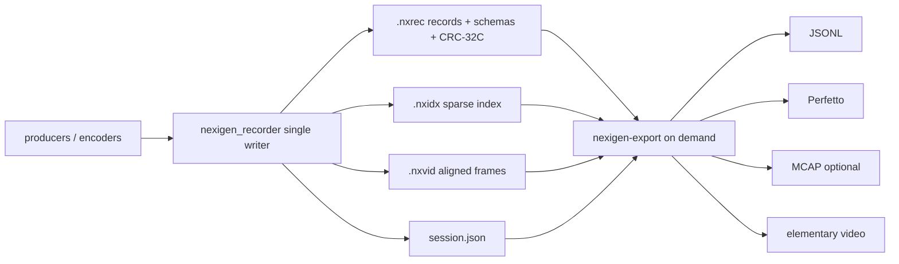

Подробности: [recorder.md](recorder.md).

## 11. Источники

- Публичные заголовки: `include/nexigen/`.
- Контракты: `openspec/specs/`.
- Цели и зависимости сборки: `CMakeLists.txt`, `tools/CMakeLists.txt`.
- [Руководство по метрикам](metrics-guide.md)
- [Управление потоками и CPU](thread-management.md)
- [Trace Daemon](trace-daemon.md)
- [nexigen-hub](nexigen-hub.md)
- [Трассировка требований безопасности](safety/traceability.md)
