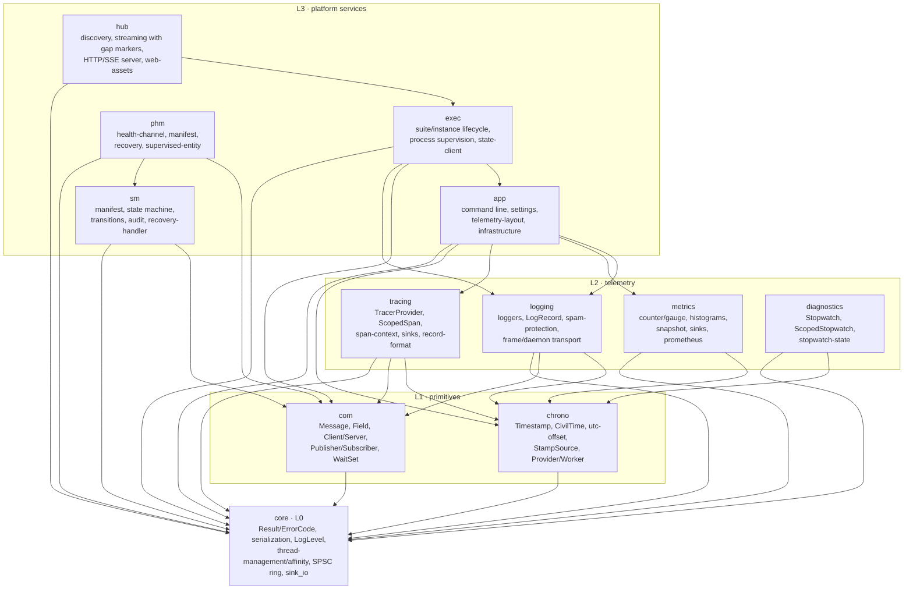
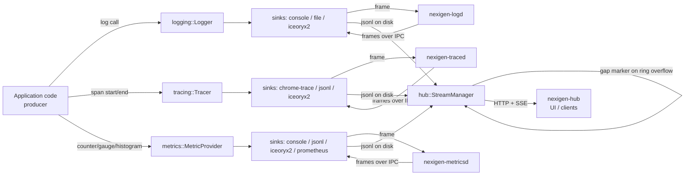
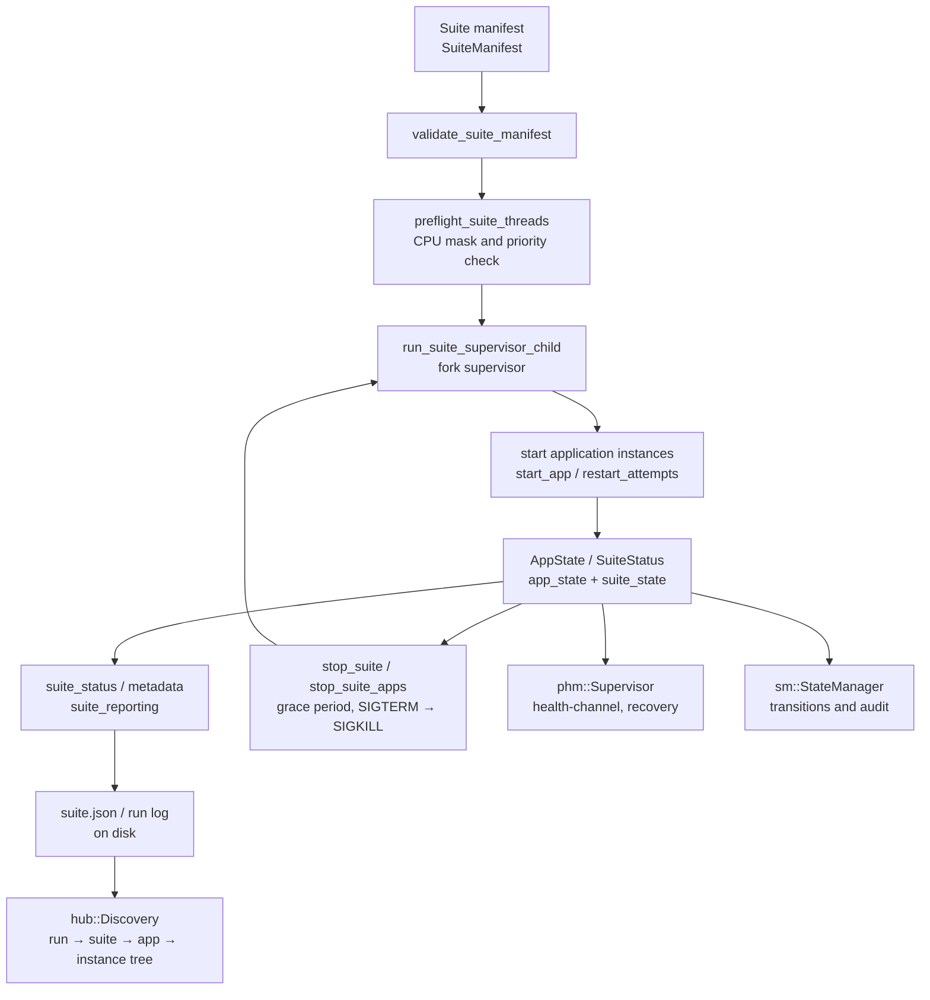

# nexigen Architecture

How the `nexigen` ecosystem is put together and the invariants every module and
contributor must keep. For per-module usage, start with
[`metrics-guide.md`](metrics-guide.md); the authoritative behaviour contract lives
in the OpenSpec capabilities under [`openspec/specs/`](../openspec/specs).

## Module map

| Namespace | Directory | Build target | Kind |
|---|---|---|---|
| `nexigen::core` | `include/nexigen/core/`, `tests/core/` | `nexigen_core` (INTERFACE) | header-only |
| `nexigen::chrono` | `include/nexigen/chrono/`, `src/chrono/` | `nexigen_chrono` | STATIC |
| `nexigen::logging` | `include/nexigen/logging/`, `src/logging/` | `nexigen_logging` | STATIC |
| `nexigen::metrics` | `include/nexigen/metrics/`, `src/metrics/` | `nexigen_metrics` (alias `nexigen::metrics`) | STATIC |
| `nexigen::tracing` | `include/nexigen/tracing/`, `src/tracing/` | `nexigen_tracing` (alias `nexigen::tracing`) | STATIC |
| `nexigen::diagnostics` | `include/nexigen/diagnostics/`, `src/diagnostics/` | `nexigen_diagnostics` (alias `nexigen::diagnostics`) | STATIC |
| `nexigen::app` | `include/nexigen/app/`, `src/app/` | `nexigen_app` (alias `nexigen::app`) | STATIC |
| `nexigen::exec` | `include/nexigen/exec/`, `src/exec/` | `nexigen_exec` (alias `nexigen::exec`) | STATIC |
| `nexigen::com` | `include/nexigen/com/`, `src/com/` | `nexigen_com` (alias `nexigen::com`) | STATIC |
| `nexigen::phm` | `include/nexigen/phm/`, `src/phm/` | `nexigen_phm` (alias `nexigen::phm`) | STATIC |
| `nexigen::sm` | `include/nexigen/sm/`, `src/sm/` | `nexigen_sm` (alias `nexigen::sm`) | STATIC |
| `nexigen::hub` | `include/nexigen/hub/`, `src/hub/` | `nexigen_hub` (alias `nexigen::hub`) | STATIC |
| examples | `examples/<module>/` | `NEXIGEN_BUILD_EXAMPLES` option | executables |
| tests | `tests/<module>/` | `NEXIGEN_BUILD_TESTS` option | CTest suites |

`nexigen::core` is INTERFACE because it is pure templates; `chrono`, `logging`,
`metrics`, `tracing`, `diagnostics`, `app`, `exec`, `com`, `phm`, `sm`, and `hub`
are STATIC because
they own compiled cold paths (calibration, the harvest loop, sink I/O, snapshot
serialisation, process supervision, HTTP/SSE serving) that must not be inlined into
every consumer. Modules never consume another module's `detail/` — the chrono extraction
established that rule (a module needing shared machinery promotes it or
duplicates it, keeping dependency arrows one-way: `metrics → chrono/core`,
`logging → chrono/core`).

`nexigen::logging` also owns the cold-path deployment surface:
`logging_settings.hpp` reads an explicitly supplied global JSON file, then a local
JSON file, then `NEXIGEN_LOG_*` environment overrides, merging field by field into
`LoggerOptions` with best-effort diagnostics. `FileLogger` adds optional
size-based segments (`app.jsonl` → `app.1.jsonl` → …) on top of the existing
period-directory rotation. Both are initialization-time features: producers never
observe the loader, and the writer performs a segment switch only at an already
cold rotation point.

`nexigen::app` is the application layer above them: `Infrastructure<Policy, ...>` is a
heap-only service owned by the application (not a base class). It owns the logger,
metric/tracing sinks and providers in a lifetime-safe order, loads per-subsystem
settings pairs, claims process-global signal ownership, blocks `SIGINT`/`SIGTERM`
before any worker starts, runs a `signalfd` watcher, and shuts down through one flush
path that logs the stop reason. A required worker-thread attribute failure follows
the same reverse-order rollback as existing initialization failures; explicit
best-effort partial application remains non-fatal and visible in worker reports.
`make_infrastructure<Policy>()` is the only
construction path; a second initialized infrastructure receives
`ErrorCode::Conflict`. The hot path is unchanged: `run()` performs one acquire load
per tick, and the watcher only records a reason. Dependency arrows stay one-way:
`app → logging, metrics, tracing, chrono, core`.

`nexigen::exec` owns detached per-instance and per-suite supervision: instance
directory layout, generated settings, fork/exec with `setsid`, signal escalation,
restart policy, and JSON-lines runner logging. Control and logger worker threads
apply a copied `ThreadSpec` and report per-attribute outcomes; warnings render the
`ThreadApplyReport`, so a best-effort partial application is visible without
claiming the thread is unpinned. `nexigen::hub` is a read-only observatory over
explicit run roots: inotify discovery, bounded stream rings with replay/gap
markers, and an epoll HTTP/SSE server with an embedded web UI. Neither module adds
work to the application tick, producer, snapshot, or sink paths; both depend on
`core`/`chrono`/`exec` in one direction only.

## Platform layers

Dependencies run strictly downward; a lower layer never knows about an upper one.
The include graph is the check: `core` includes only the standard library,
`chrono`/`com` include only `core`, telemetry includes only L0/L1, and services
may use everything below themselves.



Known deviations (both inside `detail/`, i.e. private to the module, never part
of a module's public contract):

- `metrics/detail/metric_http_server.hpp` → `hub/detail/http_parse.hpp`
  (reuses the HTTP parser instead of copying it);
- `tracing/detail/trace_daemon_session.hpp` → `exec/app_state.hpp`,
  `exec/application_state.hpp`, `sm/recovery_notification.hpp`
  (trace-daemon session state).

Candidates for a future promotion into `core`/`com` to keep the layers clean.

## Capabilities per module

Each capability under `openspec/specs/` describes one subsystem; the spec path
mirrors the module directory (`logging/log-level` → `include/nexigen/logging/`).

| Module | Headers | Purpose | Capability specs |
|---|---:|---|---|
| `core` | 20 | Shared primitives: `Result`/`ErrorCode`, the serialization mandate, the `LogLevel` vocabulary, `EnumTraits`, thread management and CPU affinity, SPSC rings, `sink_io`, settings vocabulary | `core/result`, `core/serialization`, `core/log-level`, `core/settings-vocabulary`, `core/affinity`, `core/thread-management`, `core/worker-thread`, `core/worker-tuning`, `core/spsc-ring-buffer`, `core/sink-plumbing` |
| `chrono` | 23 | Time: `Timestamp`, `CivilTime`, UTC offset, `StampSource` (rdtsc), time-source providers and their workers, sinks | `chrono/timestamp`, `chrono/time-format`, `chrono/clock-id`, `chrono/stamp-source`, `chrono/provider`, `chrono/worker`, `chrono/chrono-sink`, `chrono/chrono-snapshot`, `chrono/chrono-settings` |
| `com` | 20 | Communication: the `Message` contract, `Field`, request/response `Client`/`Server`, publish/subscribe, `EventNotifier`, `WaitSet`, service manifest | `com/field`, `com/request-response`, `com/publish-subscribe`, `com/service-management`, `com/waitset` |
| `logging` | 37 | Logging: the logger concept, the logger family (console/file/composite/null/iceoryx2), `LogRecord`, levels, spam protection, multi-producer, frame/daemon transport | `logging/logger-concept`, `logging/console-logger`, `logging/file-logger`, `logging/composite-logger`, `logging/null-logger`, `logging/iceoryx2-logger`, `logging/log-record`, `logging/log-level`, `logging/format-api`, `logging/logger-options`, `logging/logging-settings`, `logging/spam-protection`, `logging/multi-producer`, `logging/log-daemon` |
| `metrics` | 49 | Metrics: `Counter`/`Gauge`, explicit and exponential histograms, descriptive statistics, state gauge, `MetricProvider`, sinks and Prometheus rendering, daemon | `metrics/metric-concepts`, `metrics/counter-gauge`, `metrics/explicit-histogram`, `metrics/exponential-histogram`, `metrics/descriptive-statistics`, `metrics/state-gauge`, `metrics/metric-provider`, `metrics/metric-sinks`, `metrics/iceoryx2-metric-sink`, `metrics/metrics-settings`, `metrics/metrics-daemon`, `metrics/snapshot-format`, `metrics/policy-enums`, `metrics/examples` |
| `tracing` | 35 | Tracing: `TracerProvider` with per-thread SPSC shards, `ScopedSpan`, trace context (`TraceId`/`SpanId`/`SpanContext`), sinks (chrome/json/iceoryx2), record format, daemon transport | `tracing/tracer-concepts`, `tracing/tracer-provider`, `tracing/scoped-span`, `tracing/span-context`, `tracing/span-enums`, `tracing/trace-sinks`, `tracing/iceoryx2-trace-sink`, `tracing/record-format`, `tracing/tracing-settings`, `tracing/trace-daemon`, `tracing/trace-propagation`, `tracing/examples` |
| `diagnostics` | 5 | Measurement: `Stopwatch`, `ScopedStopwatch`, stopwatch state | `diagnostics/stopwatch`, `diagnostics/scoped-stopwatch`, `diagnostics/stopwatch-state`, `diagnostics/examples` |
| `app` | 11 | Application layer: command-line parsing, application settings, telemetry layout, infrastructure (subsystem init/shutdown) | `app/command-line`, `app/settings`, `app/application`, `app/telemetry-layout` |
| `exec` | 37 | Execution: suite and application-instance lifecycle, process supervision, child processes, state client, run logging | `exec/app-suite`, `exec/instance-lifecycle`, `exec/process-supervision`, `exec/application-state`, `exec/state-client`, `exec/logging` |
| `hub` | 15 | Observatory: run-tree discovery, streaming delivery with gap markers, HTTP/SSE server, web assets | `hub/discovery`, `hub/streaming`, `hub/http-api`, `hub/web-ui` |
| `phm` | 13 | Health and reliability: manifest, supervisor, health channel, checkpoints, recovery | `phm/manifest`, `phm/supervision`, `phm/health-channel`, `phm/supervised-entity`, `phm/recovery` |
| `sm` | 14 | State machine: manifest, state manager, transitions and their preparation, audit, recovery, IPC | `sm/manifest`, `sm/state-machine`, `sm/lifecycle`, `sm/telemetry`, `sm/ipc`, `sm/recovery-handler` |

Cross-cutting capabilities that are not tied to a single module:
`quality/code-structure`, `quality/coverage`, `quality/reproducible-builds`,
`packaging`, `examples`.

## Telemetry flow

Producer code calls a logger, a tracer or the metric instruments. Each provider
owns a per-thread SPSC shard; a background consumer drains batches into the
sinks; the daemons transport frames between processes, and `hub` reads the
streams from disk and serves them over HTTP/SSE.



Invariants of the flow:

- **No allocation and no blocking on the hot path.** The producer only writes to
  its own SPSC shard; logging, metrics and tracing share no state and never
  block each other.
- **Bounded rings.** When a ring overflows the consumer emits a `gap` marker
  (the lost sequence range) — loss is visible, not masked.
- **Cold path.** JSON serialization, name parsing and formatting live off the
  hot path; `core::mandate` provides the shared non-throwing contract.

## Suite and application-instance lifecycle

`nexigen-exec` reads the suite manifest, validates it, starts the supervisor
process and the application instances, then governs their restarts and shutdown.
`phm`/`sm` layer health, transitions and recovery on top of that.



## CLI tools

| Tool | Purpose | Key options |
|---|---|---|
| `nexigen-exec` | Drive suites and application instances | `--help` |
| `nexigen-hub` | HTTP/SSE observatory over run roots | `--help` |
| `nexigen-logd` | Log-frame transport daemon | `--config <path>` |
| `nexigen-traced` | Trace-frame transport daemon | `--config <trace-daemon-config.json>` |
| `nexigen-metricsd` | Metric-frame transport daemon | `--config <path>` |
| `nexigen-phmd` | Health/reliability (PHM) daemon | `--manifest <path> [--core <mask>] [--priority <n>] [--fault-log <path>]` |
| `nexigen-sm` | State-machine daemon | `--config <path> [--rt-core <mask>] [--priority <n>] [--audit-log <path>]` |

## The hard mandates

1. **C++23, no compiler extensions** (`-std=c++23`).
2. **No exceptions, no RTTI** — global `-fno-exceptions -fno-rtti`; never
   `try/catch/throw`, `dynamic_cast` or `typeid`. JSON compiles with
   `JSON_NOEXCEPTION=1`.
3. **Error model** — `nexigen::core::Result<T, E = ErrorCode>` / `core::Status`
   over `std::expected`. Branch on `has_value()`, dereference with `*res` /
   `res->`, read `.error()`. **Never `.value()`** — it aborts under
   `-fno-exceptions`.
4. **Zero heap allocation on hot paths** — producer loops, worker loops, harvest
   and sink callbacks never touch the allocator. All capacity is pre-allocated
   once at initialisation (explicitly allowed and expected).
5. **Lock-free / wait-free hot paths** — no mutexes, spinlocks or condition
   variables on hot paths. Multi-producer state uses per-thread sharding
   (`thread_local` slot registration) with `std::atomic` and explicit memory
   orders; shared atomic state is `alignas(64)` to kill false sharing.
6. **Linux high-resolution time & affinity** — `nexigen::chrono` calibrates the
   TSC against `CLOCK_MONOTONIC_RAW`; background workers pin themselves through
   the shared cold-path CPU machinery. `core::CpuSet` represents up to 1024 CPUs
   inline; `core::affinity` retains the legacy uint64 mask adapter for callers
   that only need CPUs 0–63. `ThreadSpec` adds a 15-byte name, Other/FIFO/RR
   policy and priority, and best-effort/required application. Workers apply a
   copied spec to themselves before sink startup; a required failure restores
   earlier changes and prevents the main loop, while a best-effort failure is
   exposed in `ThreadApplyReport` without stopping the worker. Reports are
   published once through release/acquire startup readiness, never per record.
   See [`thread-management.md`](thread-management.md) for the type contract and
   application order.
7. **Deferred formatting** — variadic format arguments are packed cold-side;
   never format on a producer hot path.
8. **Naming** — PascalCase types, `snake_case` functions/fields, trailing
   `snake_case_` private members; aggressive `noexcept`/`constexpr`/`[[nodiscard]]`.

## Serialization contract (all modules)

Every public class/struct/snapshot/config exposes a cold-path
`std::string to_string() const` **and** a free `to_string(const T&)`; every
public value type provides non-throwing ADL `to_json`/`from_json`
(`JSON_NOEXCEPTION=1`); every enum additionally gets `constexpr to_string` /
`from_string`; every public type is usable in `std::format` via a
`std::formatter` specialization that delegates to `to_string()`. Types whose
reconstruction is factory- or I/O-bound (instruments, composite sinks) provide
`to_json` and deliberately **no** `from_json` — the absence is compile-time
pinned in the test TU. `std::string` and `nlohmann::json` are cold-path tools
only; serialisation bodies live in compiled units (`src/*/…_format.cpp`) so they
never bloat consumer TUs.

## Hot path vs cold path

| | Hot path (per-record / per-message) | Cold path (init, diagnostics, harvest edge) |
|---|---|---|
| Allocation | never | allowed (`std::string`, `nlohmann::json`) |
| Synchronisation | wait-free atomics only | may take the control-plane mutexes |
| Failure reporting | pre-checked `Status` returns | `core::Result` branching |
| Cost budget | ns-class, measured by `*_STRICT_LATENCY` gates | unbounded |

Single-threaded instrument/log recorders use plain storage under a documented
single-writer contract; multi-threaded variants pay a locked or relaxed RMW per
record to stay exact under any thread interleaving.

## Build, test and verification matrix

```bash
# Debug (development, correctness only)
cmake -B build/debug -G Ninja -DCMAKE_BUILD_TYPE=Debug
# Release (production: -O3 -march=native + LTO, latency gates active)
cmake -B build/release -G Ninja -DCMAKE_BUILD_TYPE=Release
# Portable Release: -O3 + LTO without host-specific -march/-mtune
cmake -B build/portable -G Ninja -DCMAKE_BUILD_TYPE=Release -DNEXIGEN_NATIVE_ARCH=OFF
# Shared CI runners: optimized code without the ns-class gate
cmake -B build/release-ci -G Ninja -DCMAKE_BUILD_TYPE=Release \
      -DNEXIGEN_STRICT_LATENCY_TESTS=OFF
# ThreadSanitizer (RelWithDebInfo so the STRICT_LATENCY define stays inert)
cmake -B build/tsan -G Ninja -DCMAKE_BUILD_TYPE=RelWithDebInfo -DNEXIGEN_ENABLE_TSAN=ON
# AddressSanitizer/UBSan
cmake -B build/asan -G Ninja -DCMAKE_BUILD_TYPE=Debug -DNEXIGEN_ENABLE_ASAN=ON
# Clang (requires a C++23 standard library: std::expected)
cmake -B build/clang -G Ninja -DCMAKE_BUILD_TYPE=Debug -DCMAKE_CXX_COMPILER=clang++

cmake --build <dir> && ctest --test-dir <dir> --output-on-failure
```

`NEXIGEN_STRICT_LATENCY_TESTS` (default `ON`) controls the ns-class gates in
Release and RelWithDebInfo. CI disables them because shared runners cannot
guarantee the 20 ns budget; run the default on dedicated hardware before a
performance-sensitive release. `NEXIGEN_NATIVE_ARCH` (default `ON`) adds
`-march=native`/`-mtune=native`; set it to `OFF` for binaries that must run on
other x86-64 hosts.

Coverage instrumentation and the aggregated report target:

```bash
cmake -B build/coverage -G Ninja -DCMAKE_BUILD_TYPE=Debug -DNEXIGEN_ENABLE_COVERAGE=ON
cmake --build build/coverage --target coverage
# overall gate: -DNEXIGEN_COVERAGE_FAIL_UNDER=95
```

`coverage` cleans `.gcda`, builds and runs the eleven unit-test binaries, and prints
line coverage per module via `cmake/coverage_report.py` (stdlib only). CLI smoke
tests are excluded because they exercise subprocesses rather than instrumented
library code. The target is mutually exclusive with ASan/TSan, enforces
`runner >= 90` and `hub >= 90`, and flushes gcov counters from forked runner
supervisors before `_exit()`/`exec`, so control-plane work is measured.

Current unit-test line coverage is **95.2%** (≈11 191 / 11 753 lines):

| Scope | Coverage |
|---|---:|
| Original seven modules | 95.9% (7 341 / 7 651) |
| `runner` | 93.0% (≈2 280 / 2 452) |
| `hub` | 95.2% (≈1 570 / 1 650) |

The project target is **≥95%**. CI enforces the **≥95%** project gate
(`-DNEXIGEN_COVERAGE_FAIL_UNDER=95`) plus the 90% exec and hub module gates.
(The coverage snapshot above predates the `runner` → `exec` module rename.)
Remaining uncovered lines are concentrated in platform-specific calibration
branches, sink open/read failure paths, `std::to_chars` error arms, and
retry/fork failure arms that cannot be triggered without fault injection. The
measured baseline and the P4 backlog are recorded in
[`project-analysis.md`](project-analysis.md).

`nexigen_hub_tests` also runs a fixed-seed malformed-request corpus against the
live server. `cmake/check_result_value.py` enforces the `Result::value()` ban in
CI; it strips comments/literals and allowlists only known non-Result receivers.
The Clang CI job runs `.clang-tidy` (`bugprone-*`, `performance-*`,
`portability-*`, and clang-analyzer including the cplusplus/portability opt-ins,
excluding the intentional-padding check) over every `src/*.cpp` translation
unit with warnings treated as errors.

Formatting is a separate gate: `.clang-format` (clang-format 22.1.8, pinned in
CI through the Python package) defines the house style for every `.cpp`/`.hpp`
file under `include/`, `src/`, `tests/`, `examples/`, and `tools/`;
`cmake --build <build-dir> --target format` rewrites files in place and
`format-check` fails on any drift. Include order is intentionally preserved: the
modules group headers by ownership, and alphabetising them would obscure that
structure.

Optional verification depth:

- `-DNEXIGEN_ENABLE_FAULT_INJECTION=ON` enables test-only cold-path hooks for
  exec `pipe2`/`fork`/`/dev/null` and hub `socket`/`bind`/`epoll`/`eventfd`.
  The Debug and coverage CI builds use it; production builds compile the checks
  to constant `false`.
- `-DNEXIGEN_BUILD_FUZZERS=ON` (Clang only) builds
  `nexigen_http_parse_fuzz`, a libFuzzer harness over the pure helpers in
  `include/nexigen/hub/detail/http_parse.hpp`. CI runs a 20 000-iteration smoke
  over `tests/fuzz/corpus/http_parse`.
- `NEXIGEN_RT_INTEGRATION_TESTS=1 ./tests/nexigen_core_tests` enables the
  `rt_integration_opt_in` suite on an explicitly configured RT host with
  `CAP_SYS_NICE`. It verifies real thread names, affinity, FIFO and RR priority.
  Without the variable the suite prints a skip and requires no root or
  `CAP_SYS_NICE`; ordinary CI therefore stays unprivileged.

All five GCC modes (Debug, Release, portable Release, TSan, ASan) must report
`100% tests passed` with no sanitizer diagnostics; the Clang job must do the same
under `-Werror`. TSan and ASan are mutually exclusive.
GitHub Actions runs the same matrix, plus the coverage gate and OpenSpec
validation, from `.github/workflows/ci.yml`. Tests are zero-dependency harnesses
(`NX_CHECK` / `run_suite`, arena `operator new` counter + `mallinfo2` delta for
allocation windows); Release adds the numeric latency gates
(`NEXIGEN_METRICS_STRICT_LATENCY`), which are compiled out under Debug and
sanitizers.

## Install and package

The build exports every module target under the `nexigen::` namespace and installs
a CMake package:

```bash
cmake --install build/release --prefix /opt/nexigen
```

The prefix receives `include/nexigen/`, the eight static archives, the
`nexigen-run`/`nexigen-hub` tools, and
`lib/cmake/nexigen/{nexigenConfig,nexigenConfigVersion,nexigenTargets}.cmake`.
`nexigenConfig.cmake` resolves `Threads` and `nlohmann_json` with
`find_dependency`; installed consumers therefore link `nexigen::logging`,
`nexigen::metrics`, etc. without repeating dependency discovery. Compatibility is
same-minor (`0.1.x`).

Build-only flags (`-Werror`, LTO, sanitizers) are attached through
`$<BUILD_INTERFACE:nexigen_options>` and never leak into consumer targets. The
`nexigen::core` JSON dependency is also re-attached by the package config, which
keeps the export valid when nlohmann/json came from FetchContent.

`tests/packaging/smoke_test.sh <build-dir> [prefix]` installs into a scratch
prefix and builds `tests/packaging/consumer/`, a standalone CMake project that
uses only `find_package(nexigen CONFIG REQUIRED)`.


## Spec-driven process

Behaviour is contract-first via [OpenSpec](https://openspec.github.io/openspec/):

1. `openspec/new change` → planning artifacts (proposal → specs/design → tasks).
2. `openspec apply` works the task list; each task carries its verification.
3. `openspec sync` merges the change's capability deltas into
   `openspec/specs/**`; `openspec archive` applies remaining deltas and retires
   the change.
4. `openspec validate --specs` gates the main-spec corpus (currently 68
   capabilities / 489 requirements / 1 344 scenarios).

Archived changes live in `openspec/changes/archive/` with their full planning
history. If code and specs disagree, the spec wins — fix the code or open a
change that revises the spec; never silently drift.
