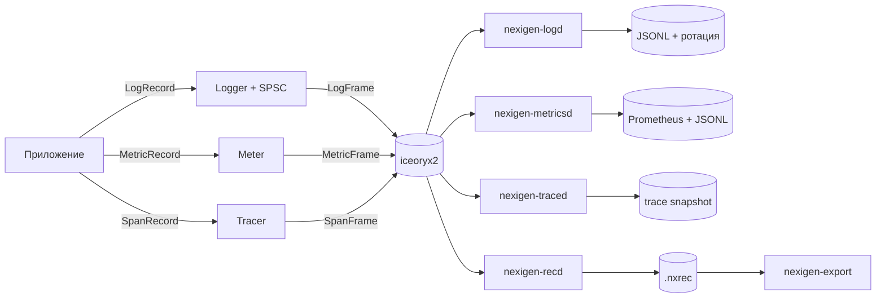
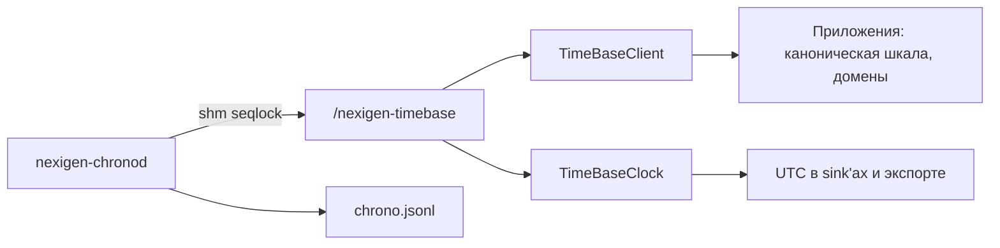
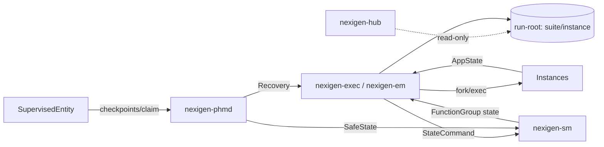

# nexigen-cpp — обзор проекта и инфраструктуры

**Версия снимка:** 26.11.2026, HEAD `9d4ee8d`.

Hard-real-time платформа на C++23 для симуляторов, HIL-стендов и систем
управления. Репозиторий содержит и саму библиотеку (исполняемые контракты для
приложений), и **инфраструктуру**: набор демонов, утилит и GUI-инструментов,
которые обеспечивают время, транспорт, телеметрию, исполнение сьютов,
управление состояниями и здоровьем.

Документ даёт карту проекта: из чего он состоит, как компоненты связаны, какие
контракты между ними и какая инженерная инфраструктура их обслуживает. Глубокие
детали — в `docs/architecture.md`, термины — в `GLOSSARY.md`, решения — в
`docs/adr/`, требования — в `openspec/specs/`.

---

## 1. Ключевые ограничения

Платформа рассчитана на жёсткий реальный масштаб времени, и это определяет
архитектуру:

- C++23, `-fno-exceptions`, `-fno-rtti`; ошибки — `nexigen::core::Result<T>` /
  `Status` (`std::expected`), `.value()` запрещён.
- Никаких аллокаций в горячих путях: всё преаллоцируется на инициализации;
  `std::string`/`nlohmann::json` — только cold path.
- Lock-free/wait-free: SPSC-кольца с per-thread шардами, `std::atomic` с
  явными `memory_order`, `alignas(64)` против false sharing.
- Время: `CLOCK_MONOTONIC_RAW` как каноническая шкала, калиброванный TSC,
  UTC только из опубликованной time base.
- Всё, что пересекает процессы, передаётся через iceoryx2 (zero-copy,
  фиксированные trivially-copyable сообщения).

---

## 2. Архитектура: модули

`include/nexigen/` — 15 модулей. Направление зависимостей — сверху вниз:

```text
        app  exec  sm  phm  recorder  hub  synchro
          \    |    |    |      |       |      /
       logging metrics tracing diagnostics  hw
              \    |     /
                 com            chrono
                    \          /
                      core
```

| Модуль | Роль |
|---|---|
| `core` | Базовые контракты: `Result`/`Status`, коды ошибок, sink-контракты, SPSC-кольца, worker thread, диагностический канал, enum-словари, настройки, thread management. |
| `chrono` | Time base: каноническая шкала, домены и коэффициенты, публикация блока, history, UTC-авторитет (`Provider`), stamp sources, time-sync monitor, timestamp. |
| `com` | Обёртки iceoryx2: `Node`, publish-subscribe, event-система, `Field` (blackboard), request-response, waitset, zero-copy samples. |
| `logging` | Логгер-API, sink'и (console/file/iceoryx2/composite), SPSC-шарды, spam protection, настройки; контракт `LogFrame` для демона. |
| `metrics` | `MetricProvider` → `Meter` → инструменты (counter, gauge, state gauge, гистограммы, статистика), snapshot'ы, sink'и, контракт `MetricFrame`. |
| `tracing` | `Tracer`/`Span`/`ScopedSpan`, `TraceHeader`, sampling, sink'и, контракт `SpanFrame`, trace daemon и дампы. |
| `diagnostics` | Cold-path измерения: `Stopwatch`, лапы, `ScopedStopwatch`. |
| `app` | Фасад приложения: `Infrastructure` (логгер+метрики+трейсинг+time base), `app.hpp` runtime, настройки, telemetry layout, run identity, graceful shutdown. |
| `exec` | Модель сьюты: манифесты (suite/machine), `Application`, `Instance`, Function Groups, EM-supervisor, state client, control host, recovery handler, deterministic execution, resource groups, trusted executables. |
| `sm` | State Manager: арбитраж Function Groups по приоритетам, RootFG, LSM, UCM, публикация состояний, аудит переходов. |
| `phm` | Platform Health Management: supervised entity, checkpoints (alive/logical/deadline), watchdog, recovery, claim/security, fault log. |
| `recorder` | Запись сессий: `.nxrec`-хранилище, writer/reader, индексы, time-base bridge, `.nxvid` для видео, модель датасетов. |
| `hub` | Локальная обсерватория: discovery run-root'ов, дерево, SSE-стримы, HTTP API, web UI. |
| `hw` | Аппаратные шины: CAN ISO-11898 (драйверы, виртуальная шина, com-транспорт, пакетный batch-протокол). |
| `synchro` | Фазово-синхронные периодические события: генератор/консьюмер, расписание, политики старта и опозданий. |

Модули собираются как STATIC-библиотеки (`nexigen_core`, `nexigen_chrono`, …),
публичные заголовки — в `include/nexigen/<module>/`, реализации — в
`src/<module>/`. Header-only части (концепты, политики) намеренно живут в
заголовках; PCH ускоряет сборку.

### Горячий и холодный пути

- **Hot path** — producer'ы логов/метрик/трейсов, тики, snapshot'ы, sink-callback'и:
  без аллокаций, без мьютексов, только атомики и преаллоцированные кольца.
- **Cold path** — конфигурация, манифесты, JSON, диагностика, демоны, GUI,
  recorder, hub: допускают `std::string`, `nlohmann::json` и файловый I/O.

---

## 3. Инфраструктурные компоненты (runtime)

### 3.1 Демоны и утилиты (19 бинарников)

| Бинарник | Роль | Ключевые контракты |
|---|---|---|
| `nexigen-chronod` | Time-base демон: публикует каноническую шкалу и таблицу доменов | сегмент `/nexigen-timebase`, history `chrono.jsonl`, интервал 100 мс |
| `nexigen-exec` | CLI экземпляров и супервизора сьюты | манифесты, `resource.json`/`exit.json`, state client |
| `nexigen-em` | Front-end Execution Manager: запускает тот же detached suite supervisor | `Nexigen/EM/*` |
| `nexigen-sm` | State Manager: арбитраж, RootFG, LSM, UCM | `Nexigen/SM/State/<group>`, `Nexigen/SM/TriggerIn` |
| `nexigen-phmd` | Platform Health Management: checkpoints, watchdog, recovery | `Nexigen/PHM/Claim`, `Recovery`, `Security`, `ExecutionState` |
| `nexigen-logd` | Агрегатор логов: принимает `LogFrame`, пишет JSONL с ротацией | `Nexigen/Log/nexigen` |
| `nexigen-metricsd` | Агрегатор метрик: последнее значение по метрике, Prometheus + JSONL | `nexigen/metrics/stream` |
| `nexigen-traced` | Центральный flight recorder: ring span'ов, дамп по инциденту | `nexigen/trace/stream`, дампы в `/var/log/nexigen/traces` |
| `nexigen-recd` | Рекордер сессий: логи, метрики, трейсы, события в одну сессию | `*.nxrec` (и `*.nxvid`) |
| `nexigen-export` | On-demand конвертер/верификатор сессий | `verify`, `inspect`, конвертация |
| `nexigen-hub` | Read-only обсерватория: дерево run'ов, стримы, SSE | HTTP `127.0.0.1:8080`, `/api/tree`, `/api/streams`, `/api/events`, `/api/health` |
| `nexigen-logview` | GUI-просмотрщик живого лога | ImGui/GLFW, независимые dock-вкладки, фильтры, find, bookmarks, экспорт |
| `nexigen-canview` | GUI-монитор CAN | ImGui/GLFW, CANopen, сессии, трассы, heatmap, клоны |
| `nexigen-canmon`, `nexigen-canrx`, `nexigen-cantx`, `nexigen-canvbus` | Консольные CAN-утилиты (монитор, приём, передача, виртуальная шина) | общий `tools/detail/can_tool_common.hpp` |
| `nexigen-canrx-hw`, `nexigen-cantx-hw` | Те же операции на реальном вендорском железе | вендорский адаптер |

Все инструменты собираются опционально (`NEXIGEN_BUILD_TOOLS`), GUI-инструменты —
отдельно (`NEXIGEN_BUILD_LOGVIEW`/`NEXIGEN_BUILD_CANVIEW` + `*_GUI`).

### 3.2 Транспорт и общие контракты

Всё межпроцессное взаимодействие идёт через `nexigen::com` (iceoryx2):

- **Сообщения**: фиксированный размер, trivially copyable, pointer-free.
- **Паттерны**: pub-sub (`Publisher`/`Subscriber`), event-система 1:N,
  `Field` (последнее значение, blackboard), request-response, waitset.
- **Имена сервисов** (примеры):

| Назначение | Сервис |
|---|---|
| Логи | `Nexigen/Log/nexigen` |
| Метрики | `nexigen/metrics/stream` (+ суффикс `Event`) |
| Трейсы | `nexigen/trace/stream` |
| Состояния Function Groups | `Nexigen/SM/State/<group>` (Field) |
| Триггеры SM | `Nexigen/SM/TriggerIn` |
| Recovery SM ↔ PHM | `Nexigen/SM/Recovery`, `Nexigen/SM/RecoveryAck` |
| Здоровье/claim PHM | `Nexigen/PHM/Claim`, `Nexigen/PHM/Security`, `Nexigen/PHM/ExecutionState` |
| Состояния приложений (EM) | `Nexigen/EM/State/<app>`, `Nexigen/EM/StateCommand` |

- **Форматы на проводе**: `LogFrame` (4 cache line), `MetricFrame`, `SpanFrame`
  (384 B), `TraceHeader` (32 B), `TimeBaseBlock` (magic `NXTB`, версия 2,
  seqlock-генерация, строки доменов, UTC/TAI-офсеты, heartbeat).
- **Хранилище**: recorder-сессия `.nxrec` (+ манифест и декларации каналов),
  `.nxvid` для видео, trace-дампы, `chrono.jsonl`, JSONL-логи и метрики hub'а.

### 3.3 Потоки данных

**Телеметрия приложения**



**Время**



**Управление сьютой и здоровьем**



**Старт приложения**

`RunIdentity` из `NEXIGEN_*` → настройки → attach time base → `Infrastructure`
(logger → metrics → tracer) → бизнес-логика → graceful shutdown с причиной
(`requested`/`SIGINT`/`SIGTERM`/`time_base_lost`).

---

## 4. Инженерная инфраструктура

### 4.1 Сборка

- CMake ≥ 3.25, генераторы Ninja и Make; PCH; ccache.
- `scripts/build.sh <build-dir…>` — сборка с `-j 64` (машина: 32 ядра /
  64 потока; правило зафиксировано в `AGENTS.md`). Логи —
  `<build-dir>/build-script.log`.
- Отдельные деревья под конфигурации: `build-asan`, `build-tsan`,
  `build-release-com`, `build-coverage`, `build-logview`, `build-canview`,
  `build-storage-bench` и т.д.
- Основные опции: `NEXIGEN_BUILD_TESTS`, `NEXIGEN_BUILD_EXAMPLES`,
  `NEXIGEN_BUILD_TOOLS`, `NEXIGEN_ENABLE_COM`, `NEXIGEN_BUILD_LOGVIEW`/
  `NEXIGEN_LOGVIEW_GUI`, `NEXIGEN_BUILD_CANVIEW`/`NEXIGEN_CANVIEW_GUI`,
  `NEXIGEN_ENABLE_ASAN`, `NEXIGEN_ENABLE_TSAN`, `NEXIGEN_ENABLE_COVERAGE`,
  `NEXIGEN_ENABLE_FAULT_INJECTION`, `NEXIGEN_STRICT_LATENCY_TESTS`,
  `NEXIGEN_BUILD_STORAGE_BENCHMARKS`.

### 4.2 Тесты

- CTest: 57 записей в Debug-дереве, больше в COM/coverage-сборках; юнит- и
  интеграционные сьюты по модулям, e2e демонов, примеры как smoke-тесты.
- Отдельные наборы под ASan/TSan и fault-injection; latency-гейты.
- GUI-тесты запускаются через `xvfb-run` и проверяют точные строки вывода
  (`UI_VIEWS`, `UI_FOCUS`, `UI_SPLASH`, `UI_ACTIONS`).

### 4.3 Гейты качества

| Гейт | Где | Что проверяет |
|---|---|---|
| Complexity | `cmake/check_complexity.py`, `complexity-check`, CTest `nexigen_complexity_gate` | CCN ≤ 15 в `include/ src/ tests/ tools/`, фильтр `alignas`-псевдофункций |
| Format | CI job `format` | clang-format 22 |
| Coverage | `coverage` target, `cmake/coverage_report.py` | line coverage, общий порог 91/92 % + пороги по модулям |
| Sanitizers | `build-asan`, `build-tsan`, CI | ASan/UBSan и TSan |
| Fault injection | `NEXIGEN_ENABLE_FAULT_INJECTION` | отказные пути control-plane |
| Latency | `NEXIGEN_STRICT_LATENCY_TESTS` | гейты задержек логирования/сенсоров |
| OpenSpec | CI job `openspec` | валидность спек и change-артефактов |

### 4.4 CI

`.github/workflows/ci.yml`, джобы: `build-test` (матрица конфигураций),
`clang`, `format`, `coverage`, `com`, `coverage-com`, `openspec`, `complexity`.
COM-джобы собирают с iceoryx2 и гоняют соответствующие интеграционные тесты.

### 4.5 Процесс и знания

- **OpenSpec** — единственный источник требований: 159 спек в
  `openspec/specs/`, изменения в `openspec/changes/` (proposal → delta specs →
  design → tasks), архив — `openspec/changes/archive/` (181 запись).
  Валидация: `openspec validate --strict`.
- **AGENTS.md** — правила для агентов: graphify, сборка `-j 64`, процесс,
  рецепт нового монитора.
- **graphify** — граф знаний в `graphify-out/` (god nodes, сообщества,
  query/path/explain), обновляется после изменений кода.
- **GLOSSARY.md** — предметный язык (включая спорные названия).
- **ADR** — `docs/adr/` (политика источников времени, диагностика,
  safe-state и др.).
- **TODO.md** — беклог с приоритетами P0–P3.
- **docs/agents/** — процессные документы: issue tracker, domain docs,
  `monitor-tool-recipe.md` (как строить новые GUI-мониторы).
- **Анализатор объёма/сложности** — `cloc` + `lizard` (skill
  `cpp-project-analyzer`), периодические снимки метрик.

---

## 5. Карта репозитория

| Путь | Содержимое |
|---|---|
| `include/nexigen/` | Публичные заголовки 15 модулей (API + концепты) |
| `src/` | Реализации модулей |
| `tests/` | Юнит/интеграционные тесты и e2e демонов |
| `tools/` | 19 бинарников: демоны, утилиты, GUI-инструменты |
| `examples/` | Самодостаточные примеры (app, logging, metrics, tracing, exec, recorder, integration) |
| `benchmarks/recorder/` | Бенчмарки форматов хранения |
| `openspec/` | Спецификации, изменения, архив, конфиг |
| `docs/` | Архитектура, ADR, статьи, runbook'и, агентские документы |
| `cmake/` | Гейты (complexity/coverage/format), санитайзеры, GUI-зависимости |
| `scripts/` | `build.sh`, `validate.sh` |
| `graphify-out/` | Граф знаний и отчёты |
| `.github/workflows/` | CI |
| `TODO.md`, `GLOSSARY.md`, `AGENTS.md` | Беклог, язык, правила |

---

## 6. Текущее состояние (снимок 26.11.2026, HEAD `9d4ee8d`)

- Объём: **~150.9 k строк** кода (project + examples), 1 064 файла C++/HPP,
  8 377 функций; средняя CCN — 3.02.
- Complexity-гейт: **красный** — `tools/nexigen-canview/ui/canview_window.cpp`
  `draw_toolbar_actions` 16 CCN; остальные превышения (4) — бенчмарки вне гейта.
- Coverage-гейт (по замеру 25.11.2026): красный на `app` (91.0 % против 95) и
  `tools` (83.7 % против 85).
- `tools/` — 24.6 % кода проекта; два GUI-инструмента (`logview`, `canview`) —
  ~78 % каталога.
- Активные change-и: `add-canview-view-titles`, `fix-com-multi-publisher-sequence`.
- Бенчмарки: 4 функции выше порога (26/26/17/17) — решение о включении
  `benchmarks/` в контракт ещё не принято.

> Снимок приведён для ориентира; актуальные цифры даёт `cpp-project-analyzer`,
> актуальные гейты — `check_complexity.py` и `coverage`.

---

## 7. Куда смотреть дальше

| Вопрос | Документ |
|---|---|
| Глубокая архитектура, диаграммы, контракты | `docs/architecture.md` |
| Термины и спорные названия | `GLOSSARY.md` |
| Решения (время, диагностика, safe state) | `docs/adr/` |
| Требования по capability | `openspec/specs/<module>/<capability>/spec.md` |
| Как вести изменение | `openspec/changes/`, `AGENTS.md` |
| Как строить новый монитор | `docs/agents/monitor-tool-recipe.md` |
| Беклог и приоритеты | `TODO.md` |
| Примеры использования | `examples/`, `docs/articles/` |
