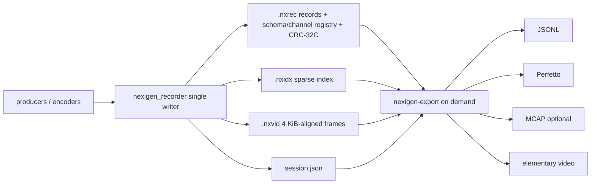

# Recorder raw format and converter

## Storage layout

```text
<session_root>/<session_id>/
  session.json
  <session>_000000.nxrec
  <session>_000000.nxidx
  <session>_000000.nxvid
  ...
```

The recorder writes a preallocated raw stream; MCAP, FFmpeg, and iceoryx2 are
not linked into `nexigen_recorder`.



## Records

- `RecordHeader` is 48 bytes: magic, type, channel, payload size, commit time,
  64-bit sequence, publisher id, header CRC-32C, payload CRC-32C.
- `IndexEntry` is 64 bytes and bounds an interval with `min_event_ns` and
  `max_event_ns`.
- `VideoFrameRef` is 64 bytes and points into the companion `.nxvid`.
- `TimeBasePayload` is 4224 bytes: generation, time-base epoch, boot token and
  full boot UUID, layout guard, aggregate status, sync mode, service flags, TAI
  and UTC offsets with uncertainty, domain count, and the 32-row
  `chrono::DomainCoefficient` table.
- `TimeSnapshot` is 896 bytes: one 1 Hz service snapshot with the hub and
  system-scale instants, TAI/UTC offsets, and every domain's id, class, epoch,
  value, lock state, and flags. It never duplicates the coefficient table.
- `SegmentFooter` is 64 bytes and carries the close CRC.
- Every segment starts with the schema and channel declarations it uses.

## Converter

`nexigen-export` is one-shot; there is no daemon, follow mode, or background
conversion.

```bash
nexigen-export list  <session-dir> [--json]
nexigen-export inspect <session-dir> [--json]
nexigen-export info  <session-dir> --dataset <id|name> [--json]
nexigen-export extract <session-dir> --dataset <id|name> [--channels <list>] \
  --format jsonl|perfetto|mcap|elementary --output <path>
nexigen-export verify <session-dir>
```

`--output` is required for every extraction command; a missing path is a usage
error (exit 2) reported on stderr, as are unknown arguments, malformed bounds
and unknown commands. `--follow`, `--watch` and `--live` are rejected with an
explicit on-demand explanation rather than a generic usage dump.

`inspect` reports the manifest itself: format version, session id, time domain,
clean state, every segment (paths, closed, records, gaps, byte counts), and the
schema/channel registry. `list` reports every dataset with size, start/end
time, gaps, closed state, and segments. `info` reports one dataset's byte
range, per-segment breakdown, schema fields/arrays, and video codec,
dimensions, extradata size, configuration epochs, and closed state. `extract`
decodes the selected datasets. `--channels` accepts a comma-separated list, so
one invocation can select several datasets; MCAP writes one channel per
dataset, JSONL/Perfetto merge the selected records, and elementary video
requires exactly one dataset. The session contains the full schema and codec
descriptors; a copied session plus the converter is sufficient for decoding.

MCAP preserves a channel's declared schema and message encoding: built-in and
JSON datasets become `jsonschema`/`json`, while opaque Protobuf/FlatBuffers
channels are passed through byte-for-byte with their encoding. When the session
contains a `TimeSync` record, MCAP timestamps are converted to UTC epoch
nanoseconds with its offset. MP4/MKV are explicitly deferred: requesting them
exits with `UnsupportedFormat` naming the `nexigen_media` follow-up.

### Two `TimeDomain` vocabularies

`recorder::TimeDomain` is the session manifest tag (`MonotonicRaw` or `Utc`),
while `chrono::TimeDomain` is the five-value platform vocabulary. Both spell the
hub as `MonotonicRaw`; channel declarations and resolver APIs use the
`chrono::TimeDomain` names, and the manifest tag only declares the session's
stamp family.

### Time base in a session

A session recorded with `nexigen-chronod` active stores `TimeBase` records
(`SessionWriter::append_time_base`) and one `TimeSnapshot` record per second
(`SessionWriter::append_time_snapshot`) and binds itself to the kernel boot and
the daemon epoch. `nexigen::recorder::TimeBaseSessionBridge` is the production
adapter: `nexigen-chronod` feeds it every published block (enabled with
`record_session_path`) and it appends one `TimeBase` record per generation — a
`Lost` block becomes an explicit gap entry — plus a snapshot record whenever the
embedded 1 Hz snapshot generation moves.

- `session.json` carries `boot_token` (16 hex), `boot_uuid`, and
  `time_base_epoch` at the top level and inside `settings`;
- every channel declares `native_domain` (`monotonic_raw`, `host_counter`, or
  `device`) plus `domain_id`/`domain_epoch` for hardware fields; an unknown
  domain name is rejected before a record is written;
- each `TimeBase` record carries the full domain table, the aggregate
  status/sync mode/service flags, the TAI/UTC offsets, and an explicit `gap`
  marker for daemon downtime; `generation` selects the row table active for the
  matching `TimeSnapshot`;
- each `TimeSnapshot` carries the per-domain values, epochs, and lock states for
  that generation without repeating the coefficient table.

The exporter resolves instants through the `TimeDomain::MonotonicRaw` hub
(`TimeBaseResolver`): the native domain value is mapped forward through the
`DomainCoefficient` row valid at that instant (or anchored at a recorded
snapshot when no row interval covers the value), the result is a hub
`CLOCK_MONOTONIC_RAW` value, and a destination row maps it back. UTC comes from
the `Realtime` row and TAI from the `Tai` row; any-to-any conversion is a
two-hop operation through the hub. JSONL lines gain `canonical_ns`, `boot`,
`utc_ns`/`utc`, `tai_ns`, and `time_base: resolved|unresolved|legacy`;
hardware payloads carrying `native_ticks` also gain `native_ns`,
`native_domain`, `domain_id`, and `domain_epoch`. An instant in a gap is
`unresolved` and never falls back to a neighbouring row or a gap entry.

Sessions written by the retired pre-contract runtime are rejected: their
`TimeBase` payload has no `TBP2` layout guard, so the resolver reports them as
`legacy` instead of reinterpreting the bytes. There is no offline converter for
sessions written by the old time-base service.


A single `.nxrec` can also be opened without `session.json`:
`SessionReader::open_segment()` reads the leading schema/channel declarations,
derives the index/video names, and rebuilds a missing index on demand. The
recovered index bounds records by commit time when a record type has no
documented event field. `SessionReader::publisher_epochs()` splits records into
publisher epochs (new publisher id or backwards sequence), and
`SessionWriter::append_time_sync()` records UTC calibration.

### Schema-driven payloads

The converter never guesses a layout and never links a producer SDK:

- `jsonschema` / `nexigen.pod.v1` with a field layout is decoded field by field
  (little-endian scalars, fixed offsets, arrays, `char[N]` strings).
- `json` / `jsonschema` without a layout is parsed as a JSON document.
- `protobuf` (`FileDescriptorSet`) and `flatbuffer` (`.bfbs`) descriptors are
  validated structurally; their payloads are emitted as opaque base64 and
  preserved byte-for-byte in MCAP.
- `ros2msg` keeps its schema text and passes the payload through.
- Any other encoding fails with a named `UnsupportedFormat` diagnostic.

JSONL lines therefore carry `payload` (decoded), `payload_base64` (opaque),
`payload_hex` (undecodable fallback), and `decode_error` when a schema is
missing or the payload does not match it.

MCAP output is optional (`-DNEXIGEN_ENABLE_MCAP=ON`) and is written as JSON
records with a generated JSON Schema. MP4/MKV remux is a follow-up after
`nexigen_media`; this revision extracts elementary video plus a timestamp
sidecar.

### Regression suite

`nexigen_export_cli` (`tools/nexigen-export/export_cli_test.cpp`) is an
automated end-to-end check: it writes a real session with the recorder library,
then runs the built `nexigen-export` binary as a child process and asserts exit
codes and output for every subcommand — usage errors, `list`/`inspect`/`info`
(both text and `--json`), schema-driven and opaque JSONL, event-time windows,
multi-channel selection, Perfetto, elementary video plus the timestamp sidecar,
MP4/MKV/unknown-format rejections, truncated-tail and corrupted-frame `verify`
diagnostics, relocated sessions, time-base resolution (a device native instant
through the hub to TAI/UTC, plus legacy-payload rejection), and MCAP (enabled,
or the documented `NEXIGEN_ENABLE_MCAP=OFF` failure). It runs in Release, Debug,
ASan, and TSan trees and needs no fixtures beyond the session it writes itself:

```bash
ctest --test-dir build -R nexigen_export_cli --output-on-failure
```
