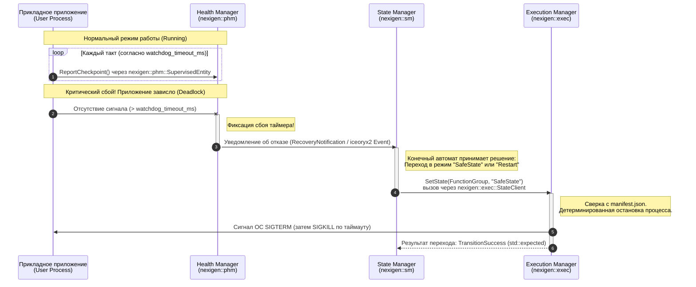

# Высокоуровневые требования: Архитектура управления состояниями платформы Nexigen

## 1. Общие положения
* **SYS-SM-001:** Корневым пространством имен для всех платформенных сервисов и SDK устанавливается **`nexigen`**.
* **SYS-SM-002:** Подсистема управления состояниями должна обеспечивать координацию режимов работы платформы, контроль работоспособности процессов и выполнение сценариев восстановления при сбоях.
* **SYS-SM-003:** Архитектурно логика управления состояниями на уровне программных интерфейсов должна быть строго разделена между тремя изолированными пространствами имен: **`nexigen::sm`**, **`nexigen::exec`** и **`nexigen::phm`**.

---

## 2. Требования к распределению ответственности по пространствам имен

### 2.1. `nexigen::sm` — Управление состояниями системы (State Management)
* **HLR-SM-010 (Назначение):** В пространстве имен `nexigen::sm` должны располагаться сервисные интерфейсы и конечные автоматы, отвечающие за принятие решений о смене глобальных режимов работы платформы или отдельных функциональных групп.
* **HLR-SM-020 (Состав модуля):** Модуль должен предоставлять интерфейсы для внешних и внутренних запросов на смену состояний, а также публикации текущего статуса (например, триггеры переходов `TriggerIn`, `TriggerOut` и интерфейсы координации обновлений `UpdateRequest`).
* **HLR-SM-030 (Стандартизация через IPC):** Взаимодействие с `nexigen::sm` должно осуществляться исключительно асинхронно через сервисно-ориентированные интерфейсы поверх межпроцессного взаимодействия (`nexigen::com` / **iceoryx2**), без жесткого связывания бизнес-логики на уровне C++ классов между процессами.

### 2.2. `nexigen::exec` — Исполнительная часть (Execution Management)
* **HLR-EXEC-010 (Назначение):** Пространство имен `nexigen::exec` должно содержать исполнительные механизмы и клиентские интерфейсы для непосредственной отдачи приказов процессу-оркестратору (Execution Manager) на запуск или остановку групп процессов.
* **HLR-EXEC-020 (Управление через StateClient):** Для отправки команд из модуля `nexigen::sm` в процесс Execution Manager должен использоваться специализированный клиентский класс **`nexigen::exec::StateClient`**.
* **HLR-EXEC-030 (Абстракции состояний):** Конфигурация групп процессов и их целевых режимов должна быть представлена строго типизированными сущностями:
  * **`nexigen::exec::FunctionGroup`** — объектное представление логической группы процессов.
  * **`nexigen::exec::FunctionGroupState`** — конкретное целевое состояние функциональной группы (например, `"NormalOperation"`, `"Autonomous"`, `"SafeState"`, `"Off"`).

### 2.3. `nexigen::phm` — Контроль здоровья платформы (Platform Health Management)
* **HLR-PHM-010 (Назначение):** Пространство имен `nexigen::phm` должно обеспечивать мониторинг временных дедлайнов (Watchdog) и логической последовательности выполнения прикладных процессов, выступая инициатором процедур восстановления при сбоях.
* **HLR-PHM-020 (Отчетность приложений):** Прикладные модули должны циклически подтверждать свою работоспособность (отправлять Checkpoint / Heartbeat) через клиентский интерфейс **`nexigen::phm::SupervisedEntity`**.
* **HLR-PHM-030 (Цепочка эскалации сбоев):** При фиксации зависания приложения или нарушения временного дедлайна модуль `nexigen::phm` обязан отправить уведомление о сбое в `nexigen::sm`. Модуль `nexigen::sm`, обработав сбой через конечный автомат, должен отдать команду через `nexigen::exec::StateClient` на перезапуск сбойной группы процессов или перевод платформы в безопасное состояние (`SafeState`).

---

## 3. Схема взаимодействия подсистем (Sequence Diagram)

Ниже представлена утвержденная последовательность взаимодействия пространств имен при штатном мониторинге и обработке критического сбоя (Watchdog Timeout):

---

## 4. Требования к реализации межпроцессного взаимодействия (C++23 + iceoryx2)

* **HLR-IPC-010 (Канал `App -> nexigen::phm`):** Должен быть реализован через публикацию плоской (`trivially_copyable`) структуры состояния в разделяемую память **iceoryx2** (паттерн Publish-Subscribe в связке с Events для мгновенной нотификации).
* **HLR-IPC-020 (Канал `nexigen::phm -> nexigen::sm`):** Передача событий об отказах должна осуществляться без динамических аллокаций памяти через механизм событий **iceoryx2 Events** (или lock-free очередь при размещении внутри единого процесса оркестратора в рамках MVP).
* **HLR-IPC-030 (Канал `nexigen::sm -> nexigen::exec`):** Вызовы `nexigen::exec::StateClient` должны использовать паттерн **Request-Response** в **iceoryx2**, обеспечивая асинхронную отправку команды на смену состояния и гарантированное получение статуса завершения переключения процессов.
