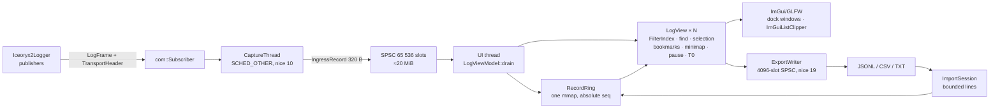

# Спецификация программы `nexigen-logview`

| Параметр | Значение |
|---|---|
| Документ | `log_view_spec.md` |
| Версия | 1.0 |
| Дата | 2026-11-24 |
| Статус | Реализовано в репозитории; документ описывает фактическое поведение |
| Область | Утилита `nexigen-logview` (просмотрщик журнала `LogFrame` в реальном времени) |
| Нормативные источники | `openspec/specs/logview/*`, `docs/specs/logview/*`, `docs/architecture.md` §5.1b, исходный код `tools/nexigen-logview/` |
| Назначение документа | Единая спецификация просмотрщика и основа для спецификации монитора CAN (`nexigen-canmon`) |

---

## 1. Назначение и область

### 1.1 Назначение

`nexigen-logview` — десктопная утилита для приёма, хранения, фильтрации, визуализации и экспорта потока записей журнала (`nexigen::logging::LogFrame`) от приложений платформы nexigen. Утилита работает поверх шины `nexigen::com` (iceoryx2), не изменяет состояние платформы и является read-only потребителем журнала.

Утилита решает четыре задачи:

1. **Наблюдение в реальном времени.** Поток записей отображается без потери отзывчивости при нагрузке свыше 50 000 сообщений/с.
2. **Анализ.** Фильтры, поиск, закладки, режимы времени и дельт, T0-якорь, инспектор записи, миникарта.
3. **Ретроспектива.** Открытие ранее сохранённых JSONL-файлов (в том числе файлов `nexigen-logd`) и текстовых журналов без подключения к шине.
4. **Передача данных.** Асинхронный экспорт выделенных записей в JSONL, CSV или TXT.

### 1.2 Область действия

В документ входят:

- модель данных и ограничения памяти;
- приём из шины, рукопожатие с издателями, обработка потерь;
- независимые представления (`LIVE`/`PAUSED`), фильтрация, поиск, выделение;
- отображение времени и вычисление дельт;
- пользовательский интерфейс, горячие клавиши, конфигурация;
- экспорт/импорт, ресурсные предохранители, командная строка;
- нефункциональные требования, ограничения, тесты и трассируемость.

В документ **не входят**:

- формат и реализация издателей журнала (`Iceoryx2Logger`, `nexigen-logd`);
- контракт сервиса журнала `Nexigen/Log/nexigen` (описан в `docs/specs/logging/*`);
- политика хранения журналов на диске и квоты;
- CAN-транспорт и CAN-устройства (см. `docs/specs/hw/can/*`), кроме приложения A, где показано, как перенести требования на монитор CAN.

### 1.3 Связь с монитором CAN

Документ сознательно построен как **шаблон архитектуры realtime-монитора**:

- приём фиксированных записей из `nexigen::com`;
- ограниченная кольцевая история с абсолютной нумерацией;
- независимые представления над общей историей;
- фильтрация/поиск/выделение/закладки;
- режимы времени и дельт;
- асинхронный экспорт и офлайн-импорт;
- ECO-режим и бюджеты памяти.

Приложение A даёт прямое соответствие «лог → CAN»: `LogFrame → CanMessage/CanChannelStatus`, `app_id → канал`, `LogLevel → вид кадра`, `payload → данные кадра`, `T0/Delta → период кадра и джиттер`. Требования с префиксом `LV-` можно переиспользовать с заменой модели данных и источников.

### 1.4 Термины

| Термин | Определение |
|---|---|
| `LogFrame` | Фиксированный 256-байтный POD-кадр журнала, передаваемый по шине. |
| Запись (record) | Слот истории: либо принятый `LogFrame`, либо синтетическая запись о потере. |
| Sequence (`seq`) | Абсолютный 64-битный номер записи, назначаемый при приёме и не меняющийся при вытеснении. |
| LIVE view | Представление, читающее общую живую историю и следующее за новыми записями. |
| PAUSED view | Представление над неизменяемым снимком (`FrozenHistory`), не более 1 MiB записей. |
| Ingress queue | Односвязная SPSC-очередь `IngressRecord` на 65 536 слотов между потоком приёма и UI. |
| Gap record | Синтетическая запись, сообщающая о пропущенных записях (транспорт, ingress, издатель). |
| T0 | Одна запись, выбранная якорем для относительного времени и дельт. |
| ECO | Режим экономии ресурсов: снижение FPS и частоты пересчёта при перегрузке. |
| Источник (`Sources`) | Обнаруженный `app_id`, которому назначен цвет и ведутся счётчики. |
| Find | Поиск по видимому порядку без скрытия строк, в отличие от фильтра. |

---

## 2. Обзор системы

### 2.1 Контекст



Утилита однонаправленно читает шину. Остановка просмотрщика не влияет на издателей и не создаёт сервисов.

### 2.2 Компоненты

| Компонент | Файл | Ответственность |
|---|---|---|
| `CaptureThread` | `backend/capture_thread.hpp/.cpp` | Открывает узел, подписчика, `EventListener` и `WaitSet`; вычитывает кадры и помещает `IngressRecord` в очередь; ведёт счётчики. |
| `IngressRecord` | `model/ingress_record.hpp` | 320-байтная запись передачи: кадр + вид + число потерянных до него. |
| `LogViewModel` | `model/log_view_model.hpp/.cpp` | Единая модель: история, виды, импорт/экспорт, guard, реестр приложений. Вызывается только из UI-потока. |
| `RecordRing` | `model/record_ring.hpp/.cpp` | Кольцевая история фиксированной ёмкости в одном `mmap`, абсолютная нумерация, вытеснение старых. |
| `LogView` | `model/log_view.hpp/.cpp` | Независимое состояние представления: фильтр, find, выделение, закладки, пауза, миникарта, T0, режимы времени. |
| `FilterIndex` / `FilterCriteria` | `model/filter.hpp/.cpp` | Критерии и инкрементальный индекс видимых записей. |
| `FindState` | `model/find_state.hpp/.cpp` | Поиск по видимому порядку с ленивым массивом совпадений. |
| `Minimap` | `model/minimap.hpp/.cpp` | 1024 бакета плотности Error/Fatal/закладок. |
| `TimeContext` / `TimeFormatter` | `model/time_context.*`, `model/time_formatter.*` | Режимы времени, T0, дельты, адаптивные единицы, аномалии. |
| `ColorManager` | `model/color_manager.hpp/.cpp` | Цвета уровней и палитра приложений, режимы `Combined`/`Criticality`. |
| `AppRegistry` | `model/app_registry.hpp/.cpp` | Фиксированная таблица на 256 `app_id` с устойчивым индексом цвета. |
| `ExportWriter` | `model/export_writer.hpp/.cpp` | Асинхронный экспорт через SPSC-очередь на 4096 записей. |
| `ImportSession` | `model/importer.hpp/.cpp` | Построчный импорт JSONL/текста с прогрессом и подсчётом ошибок. |
| `ResourceGuard` | `model/resource_guard.hpp/.cpp` | Гистерезисный переход NORMAL ↔ ECO по CPU и частоте потока. |
| `LogViewConfig` | `model/logview_config.hpp/.cpp` | Загрузка/сохранение JSON-конфигурации, валидация. |
| `run_ui` / `run_headless` | `ui/logview_window.*`, `headless.*` | Оконный и безоконный режимы. |

### 2.3 Потоки и владение данными

| Поток | Приоритет | Что делает | Что не делает |
|---|---|---|---|
| Приём (`lgview-rx`) | `SCHED_OTHER`, nice 10 | Ждёт события `WaitSet`, вычитывает пакеты, копирует `LogFrame` в `IngressRecord`, считает потери. | Не форматирует, не фильтрует, не аллоцирует. |
| UI | обычный | Вычитывает ingress-очередь, пишет историю, ведёт индексы, рисует, обрабатывает ввод. | Не блокируется на транспорте и файловых операциях. |
| Экспорт (`lgview-ex`) | nice 19 | Форматирует и пишет выбранные записи. | Не читает шину и не трогает историю. |

История имеет единственного владельца — UI-поток. Поэтому в `RecordRing` нет атомиков и блокировок: синхронизация ограничена SPSC-очередью приёма и очередью экспорта.

### 2.4 Режимы работы

| Режим | Признак | Поведение |
|---|---|---|
| Live GUI | по умолчанию | Подключение к сервису, окно, dock-представления. |
| Offline GUI | `--offline <file>` | Импорт файла без подключения к COM; живой статус отображается как недоступный. |
| Headless | `--headless` | Модель без OpenGL/GLFW; печать записей в stdout. |
| Mock/soak | `--mock <n>`, `--soak <s>` | Синтетический поток для нагрузочных проверок. |
| Scripted UI | `--ui-*` | Драйверы для CI под Xvfb (smoke, actions, input, views, focus, splash). |

---

## 3. Модель данных

### 3.1 `LogFrame` (входной кадр)

`nexigen::logging::LogFrame` — тривиально копируемый тип, `alignas(64)`, ровно 256 байт, без указателей.

| Поле | Тип | Смысл |
|---|---|---|
| `timestamp_ns` | `uint64` | Мононотонный штамп производителя, нс. |
| `app_id[16]` | `char[16]` | 16-байтный код приложения, дополнен NUL. |
| `context_id` | `uint32` | Зарезервированный идентификатор контекста (сейчас 0). |
| `thread_id` | `uint32` | Кэшированный `gettid` потока-производителя. |
| `pid` | `uint32` | PID процесса-производителя. |
| `dropped_counter` | `uint32` | Приращение счётчика потерь издателя с предыдущего кадра. |
| `payload_size` | `uint16` | Длина текста в `payload`. |
| `version` | `uint16` | Версия формата; поддерживается `2`. |
| `log_level` | `uint8` | `Verbose, Debug, Info, Warning, Error, Fatal, Off`. |
| `payload[211]` | `uint8[211]` | Текст сообщения, не NUL-терминированный. |

Ограничения: кадр не содержит указателей; текст длиннее 211 байт обрезается издателем. Просмотрщик обязан считать `payload_size` ограниченным размером массива, даже если поле повреждено.

### 3.2 `IngressRecord` (передача в UI)

```
IngressRecord: kind (RecordKind), lost_before (uint64), frame (LogFrame)   // 320 B, alignas(64)
```

`lost_before` — число записей, пропущенных транспортом до этого кадра. Для синтетических записей поле несёт количество потерянных записей.

### 3.3 Виды записей

| `RecordKind` | Значение | Учитывается как принятый кадр |
|---|---|---|
| `Frame` | Принятый `LogFrame`. | Да |
| `TransportGap` | Пропуск, о котором сообщил транспорт. | Нет |
| `IngressOverflow` | Переполнение очереди приёма (UI не успел). | Нет |
| `PublisherDrop` | Потери, о которых сообщил счётчик издателя. | Нет |

Синтетические записи занимают слот истории, отображаются отдельно со счётчиком пропущенных и не входят в счётчик принятых кадров.

### 3.4 История и ёмкость

- Одно анонимное `mmap`-отображение содержит массивы кадров, видов записей и дельт «предыдущий кадр того же приложения».
- Ёмкость — степень двойки; выделяется один раз при старте и не переаллоцируется.
- `head` — старейший удерживаемый номер, `tail` — на единицу больше новейшего.
- При переполнении вытесняется старейшая запись; счётчик `evictions` растёт.

Формула ёмкости:

```
available = max(0, budget_bytes − ingress_bytes − fixed_reserve)
capacity  = bit_floor(max(1024, available / 273))
ingress_bytes  = 65 536 × 320 B ≈ 20 MiB
fixed_reserve  = 32 MiB
```

| Бюджет `max_memory_mb` | Ёмкость истории |
|---|---|
| 256 (по умолчанию) | 524 288 записей |
| 384 | 1 048 576 записей |
| 16 (минимум) | 1 024 записи |

### 3.5 Реестр приложений

`AppRegistry` — таблица с открытой адресацией на 256 слотов:

- новый `app_id` получает следующий индекс палитры, который не меняется до сброса;
- при заполнении таблицы новые идентичности не регистрируются, но кадры сохраняются;
- счётчики записей и последний штамп обновляются при приёме и вытеснении.

### 3.6 JSONL-представление (экспорт/импорт)

Одна строка — один объект. Поля совместимы с `nexigen-logd`:

```json
{"timestamp":"2026-11-24T00:00:00.000000000Z","mono_ns":1000000000,"boot":"8d1a2b3c4d5e6f70","app":"Engine","level":"info","thread_id":1,"pid":100,"seq":1,"delta_ns":0,"kind":"frame","message":"offline first"}
```

| Поле | Тип | Примечание |
|---|---|---|
| `timestamp` | строка ISO-8601 UTC | Абсолютное UTC, вычисленное из `mono_ns` и контекста времени экспорта. |
| `mono_ns` | число | Исходный монотонный штамп. |
| `boot` | строка | Токен загрузки; несовпадение — признак смешанных сессий. |
| `app` | строка | `app_id` (до 16 символов). |
| `level` | строка | `verbose`, `debug`, `info`, `warning`, `error`, `fatal`, `off`. |
| `thread_id`, `pid` | число | Метаданные производителя. |
| `seq` | число | Абсолютный номер записи. |
| `delta_ns` | число | Дельта для контекста экспорта. |
| `kind` | строка | `frame` или синтетический вид. |
| `message` | строка | Экранированный текст; для gap-записи — описание потери. |

CSV и TXT содержат те же колонки в табличной форме; CSV использует корректное кавычкование.

---

## 4. Функциональные требования

Формулировки «ДОЛЖНА» нормативны. Каждое требование имеет идентификатор `LV-<группа>-<номер>`.

### 4.1 Захват (`LV-CAP`)

#### LV-CAP-01. Подключение к сервису журнала
Утилита ДОЛЖНА подписываться на настроенный сервис (по умолчанию `Nexigen/Log/nexigen`) и показывать кадры с момента подключения. Она НЕ ДОЛЖНА требовать или ждать накопленного backlog.

**Приёмка:**
- при старте без издателей показывается состояние ожидания, а первый опубликованный кадр появляется без перезапуска;
- при старте поверх работающего suite новые кадры появляются сразу;
- при простое приём спит в ядре и не потребляет CPU.

#### LV-CAP-02. Проверка версии формата
Кадр с `version ≠ 2` ДОЛЖЕН отбрасываться, учитываться в счётчике `rejected` и не интерпретироваться. Допустимые кадры продолжают отображаться.

#### LV-CAP-03. Приём не блокирует UI
Приём ДОЛЖЕН идти в отдельном потоке и продолжать вычитывать транспорт, пока UI занят. Фиксированная очередь передачи не должна расти.

#### LV-CAP-04. Потери видимы
Каждая обнаруженная потеря ДОЛЖНА становиться отдельной gap-записью с числом пропущенных. Потери транспорта, переполнение ingress-очереди и счётчик издателя учитываются раздельно.

**Приёмка:**
- пропуск N кадров по последовательности даёт одну запись «N потеряно» в соответствующей позиции;
- переполнение очереди приёма даёт одну запись `ingress_overflow` при возобновлении разбора;
- ненулевой `dropped_counter` кадра отражается рядом с кадром и в итогах сессии.

#### LV-CAP-05. Наблюдаемость транспорта
Состояние ДОЛЖНО показывать имя сервиса, число издателей, счётчики received/lost/rejected, занятость очереди передачи и последнюю ошибку транспорта. Ошибка приёма не завершает просмотр и не делает историю недоступной.

#### LV-CAP-06. Разделение счётчиков
Счётчики принятых кадров, синтетических записей и вытесненных записей ведутся раздельно и отображаются в тулбаре и панели `Status`.

### 4.2 История (`LV-HIS`)

#### LV-HIS-01. Ёмкость из бюджета памяти
Ёмкость ДОЛЖНА вычисляться по бюджету (`max_memory_mb`, по умолчанию 256), округляться вниз до степени двойки и выделяться один раз до старта приёма и отрисовки. Рост и переаллокация в рантайме запрещены.

**Приёмка:** при бюджете 256 MiB ёмкость 524 288; при 384 MiB — 1 048 576; при невозможности выделить память утилита завершается с видимой ошибкой до старта захвата.

#### LV-HIS-02. Абсолютная идентичность записи
Каждая запись получает монотонно возрастающий 64-битный номер при приёме. Вытеснение НЕ ДОЛЖНО перенумеровывать оставшиеся записи. Импортированные записи нумеруются заново с первой импортированной.

#### LV-HIS-03. Вытеснение старейших
При заполнении истории приём новой записи вытесняет старейшую. Счётчик вытеснений ДОЛЖЕН расти и отображаться, а не заменяться молчаливой потерей данных.

#### LV-HIS-04. Пауза замораживает представление, а не приём
Пауза ДОЛЖНА фиксировать отображаемый диапазон, продолжая приём и запись в историю. Когда вытеснение достигает нижней границы замороженного диапазона, граница сдвигается к старейшей удерживаемой записи, а баннер сообщает число перезаписанных отображаемых записей.

**Приёмка:**
- после паузы и прихода больше ёмкости записей представление переходит к старейшей удерживаемой записи и показывает баннер;
- возобновление следует за новейшей записью и возвращает бейдж `LIVE`;
- ручная прокрутка отключает автоскролл.

#### LV-HIS-05. Принятые и синтетические записи различимы
Синтетические записи ДОЛЖНЫ иметь отдельную визуальную трактовку, указывать число пропущенных и не увеличивать счётчик принятых кадров.

### 4.3 Фильтрация, поиск, выделение (`LV-FLT`)

#### LV-FLT-01. Фильтры компонуются и не удаляют данные
Фильтрация ДОЛЖНА поддерживать любую комбинацию: видимость приложений, видимость уровней и подстроку текста. Фильтр скрывает строки только из таблицы; снятие критерия возвращает ранее скрытые записи.

#### LV-FLT-02. Инкрементальный индекс видимых записей
Утилита ДОЛЖНА поддерживать упорядоченное множество номеров видимых записей. Новые подходящие записи добавляются без полного пересканирования. Смена критерия применяется порциями не более 20 000 записей за кадр с индикатором прогресса.

**Приёмка:**
- запись, подходящая под фильтр, появляется в конце видимого набора сразу;
- смена фильтра по полной истории идёт несколькими кадрами, показывает прогресс и не блокирует UI;
- вытесненная до обработки запись пропускается, а не отображается устаревшей.

#### LV-FLT-03. Find не фильтрует
Поиск (`Ctrl+F`) ДОЛЖЕН сохранять все видимые строки, подсвечивать совпадения и поддерживать переход к следующему/предыдущему совпадению. Текст поиска независим от фильтра.

**Приёмка:**
- совпадения подсвечиваются жёлтым внутри текста сообщения;
- Enter выполняет поиск и переходит к первому совпадению; переход «следующее/предыдущее» циклический;
- при нуле совпадений показывается `0 matches`, таблица не меняется.

#### LV-FLT-04. Выделение привязано к записи
Выделение ДОЛЖНО поддерживать клик, `Shift+клик` по видимому порядку, `Ctrl+клик` и `Ctrl+A` для всех отфильтрованных записей. Выделение ссылается на номера записей и переживает смену фильтра и прокрутку.

#### LV-FLT-05. Закладки уровня записи
`F2` ДОЛЖНА переключать закладку на выбранной записи. Утилита ДОЛЖНА переходить к следующей/предыдущей закладке, показывать их на миникарте и сохранять при фильтрации и прокрутке.

### 4.4 Время и дельты (`LV-TIM`)

#### LV-TIM-01. Режимы штампа времени
ДОЛЖНЫ поддерживаться режимы `Absolute (UTC)`, `Since Boot` и `Relative to T0`.

- `Absolute` использует платформенную временную базу (`TimeBaseClock`, точка `/nexigen-timebase`), если она подключена; иначе — выборочное смещение UTC и явное состояние «time base отсутствует».
- `Since Boot` рендерит монотонный штамп как смещение от загрузки.
- `Relative to T0` рендерит знаковое смещение от якоря.

**Приёмка:** при отсутствии time base интерфейс явно показывает состояние `sampled offset` (панель `Status`) и признак `no time base` у некалиброванного штампа, а `Since Boot` остаётся точным; `Absolute` не выдаёт догадку за калиброванное UTC.

#### LV-TIM-02. Режимы дельты
Дельта ДОЛЖНА вычисляться одним из способов: от предыдущей видимой записи, от предыдущей записи того же приложения, от якоря T0. Единицы адаптивные (`нс`, `мкс`, `мс`, `с`), отрицательная дельта отображается со знаком минус и не обнуляется.

#### LV-TIM-03. Аномальные дельты
Дельта выше настраиваемого порога (по умолчанию 50 мс) ДОЛЖНА подсвечиваться. Порог сохраняется между запусками.

#### LV-TIM-04. Один якорь T0
Якорь ДОЛЖЕН устанавливаться из контекстного меню строки или клавишей `T`, подсвечиваться и быть только один. Новый якорь заменяет предыдущий; `Clear T0` снимает его.

#### LV-TIM-05. Порядок прихода сохраняется
Сортировка записей по времени запрещена. Режимы времени меняют только форматирование, но не порядок истории. При приходе записи с более ранним штампом дельта может быть отрицательной.

### 4.5 Представление (`LV-PRS`)

#### LV-PRS-01. Цвета уровней и приложений
Пользователь ДОЛЖЕН задавать цвет текста и, опционально, фон для каждого уровня; каждое новое приложение получает отдельный цвет из палитры. Настройки редактируются в рантайме и сбрасываются.

**Значения по умолчанию:** `Fatal` — светлый текст на тёмно-красном фоне; `Error` — красный; `Warning` — янтарный; `Info` — светло-серый; `Debug`/`Verbose` — приглушённые.

#### LV-PRS-02. Два режима раскраски
- `Combined`: колонка приложения окрашена цветом приложения, `Level`/`Message` — цветом уровня.
- `Criticality`: для `Error`/`Fatal` вся строка использует цвет уровня независимо от цвета приложения.

#### LV-PRS-03. Dockable-компоновка
Интерфейс ДОЛЖЕН состоять из глобального тулбара, левой панели `Sources`, одной или нескольких dock-панелей `Log` (по одной на представление) и сворачиваемого нижнего `Inspector`. Компоновка и порядок окон восстанавливаются при перезапуске.

#### LV-PRS-04. Виртуализированная таблица
Таблица ДОЛЖНА отрисовывать только видимые строки (`ImGuiListClipper`) и оставаться отзывчивой при полной истории. Колонки: закладка, `#`, `Timestamp`, `Delta`, `App`, `Context`, `Level`, `Message`.

#### LV-PRS-05. Инспектор одной записи
Инспектор ДОЛЖЕН показывать выбранную запись сфокусированного представления: полный текст, `index`, `kind`, `timestamp`, `delta`, `application`, `context`, `level`, `thread`, `pid`, счётчик потерь издателя, версию формата и кнопку копирования. Если длина текста равна ёмкости кадра, выводится предупреждение о возможном усечении издателем.

#### LV-PRS-06. Тулбар отражает состояние
Глобальный тулбар ДОЛЖЕН показывать `Open`, `Clear`, `Colors`, `Reset colors`, `Reset config`, режим ресурсов (`NORMAL`/`ECO` с причиной), счётчики и прогресс импорта/экспорта. Каждое окно `Log` показывает собственные `Pause/Resume`, счётчик новых записей на паузе, видимое/полное количество, частоту и `Save selected`.

#### LV-PRS-07. Миникарта
Рядом с таблицей ДОЛЖНА отображаться миникарта на 1024 бакета, помечающая плотность `Error`, `Fatal` и закладок по всей истории и обновляющаяся при приёме и вытеснении.

#### LV-PRS-08. Масштаб UI для High-DPI
Поддерживается локальный масштаб шрифта, метрик ImGui и начального окна:

- `--ui-scale <factor>` в диапазоне `0.5…4.0`;
- без флага масштаб берётся из content scale основного монитора и ограничивается `1.0…4.0`;
- масштаб не влияет на данные, бюджет памяти, сервис и форматы экспорта/импорта;
- некорректный масштаб завершает запуск с кодом ошибки аргументов.

#### LV-PRS-09. Уникальная идентичность строк
Каждая видимая строка ДОЛЖНА иметь идентификатор взаимодействия, производный от абсолютного номера записи. Наведение, клик и контекстное меню не должны выдавать ошибку конфликта ID ImGui и перекрашивать таблицу.

#### LV-PRS-10. Копирование текста строки
Полный текст записи доступен при наведении и копируется:

- `Ctrl+C` копирует строку под курсором, иначе выбранную;
- контекстное меню строки содержит `Copy message` и `Copy full record`.

#### LV-PRS-11. Навигация «первая/последняя» и автоскролл
В каждом представлении ДОЛЖНЫ быть отдельные действия `First`, `Last` и переключатель автоскролла:

- `First` переходит к старейшей видимой записи и выключает автоскролл;
- `Last` переходит к новейшей видимой записи и не меняет переключатель;
- ни одно действие не меняет выделение, фильтры, закладки, T0 и паузу;
- пустое представление не меняется;
- новое `LIVE`-представление стартует с включённым автоскроллом;
- ручная прокрутка отключает автоскролл; пауза приостанавливает следование, не меняя переключатель.

#### LV-PRS-12. Стартовый splash
При интерактивном запуске ДОЛЖЕН показываться неинтерактивный splash с встроенным изображением в течение одной секунды. Приём и разбор в это время продолжаются. Изображение масштабируется равномерно с letterbox. При ошибке загрузки изображения утилита сообщает о ней и открывает рабочее пространство. Headless и scripted-режимы splash пропускают.

### 4.6 Независимые представления (`LV-VIEW`)

#### LV-VIEW-01. Представления — независимые dock-окна
Каждое представление ДОЛЖНО быть отдельным dock-окном с заголовком. ImGui может объединять их во вкладки или показывать рядом. Закрытие представления освобождает его состояние и ресурсы, не затрагивая остальные.

#### LV-VIEW-02. Изоляция состояния
Каждое представление владеет: фильтром источника, фильтрами уровней и текста, индексом видимых записей, find, выделением, закладками, миникартой, паузой/позицией прокрутки, режимами времени и дельты, порогом аномалии, якорем T0 и выбором для экспорта.

Общими остаются: захват, живая история, реестр приложений, цвета, временная база, ECO, масштаб UI и dock-компоновка.

#### LV-VIEW-03. `All` и source-представления
- По умолчанию открывается `All logs`; оно закрываемо, открываемо заново и считается одним `LIVE`-представлением.
- Source-представление фиксировано на одном `app_id`.
- Левая панель `Sources` — глобальный каталог и пусковая площадка; `All` управляет видимостью источников через локальный popup `Sources...`.

#### LV-VIEW-04. Диалог клонирования
Клонирование сфокусированного представления ДОЛЖНО открывать диалог выбора `LIVE`/`PAUSED` с независимыми флажками копирования: уровни, текстовый фильтр, режим времени, режим дельты, порог аномалии, выделение, закладки, T0, строка поиска. По умолчанию все флажки включены. Источник наследуется всегда; позиция прокрутки не копируется.

#### LV-VIEW-05. `LIVE`-клон
`LIVE`-клон ДОЛЖЕН подключаться к общей живой истории, следовать новым записям и получать независимое состояние согласно диалогу. Он стартует с новейших записей.

#### LV-VIEW-06. `PAUSED`-клон — ограниченный снимок
`PAUSED`-клон ДОЛЖЕН копировать неизменяемый снимок не более 1 MiB данных записей. Source-представление копирует своё приложение, `All` — все. Записи выбираются от новейших к старейшим и материализуются в порядке последовательности. Gap-записи в диапазоне включаются и учитываются в бюджете. Все уровни и текст копируются независимо от текущих фильтров; абсолютные номера сохраняются; выделение/закладки вне снимка отбрасываются, T0 вне диапазона сбрасывается, строка поиска перезапускается на клоне.

#### LV-VIEW-07. Пределы и персистентность
- Не более 8 `LIVE`-представлений, включая `All`.
- Не более 16 `PAUSED`-представлений.
- Превышение предела отклоняется с видимым сообщением; представление не создаётся частично.
- В конфигурации сохраняются только `LIVE`-представления; `PAUSED` — сессионные.
- Выделение, закладки, T0, строка поиска и прокрутка — сессионные.
- Если сохранённых `LIVE`-представлений нет, открывается пустое рабочее пространство с предложением открыть `All` или источник.

#### LV-VIEW-08. Экспорт на представление, один писатель
Каждое представление владеет своим выбором для экспорта. `Save selected` снимает копию выбора и передаёт её единственному глобальному писателю. Второй экспорт во время активного отклоняется. Закрытие исходного представления не отменяет уже скопированный экспорт.

#### LV-VIEW-09. Фокус маршрутизирует действия
Копирование, пауза, закладка, навигация по вниманию и find ДОЛЖНЫ действовать на последнее сфокусированное представление. Инспектор показывает запись сфокусированного представления. Если фокуса нет, глобальные горячие клавиши игнорируются.

### 4.7 Офлайн-режим и конфигурация (`LV-OFF`)

#### LV-OFF-01. Сохранение выбранных записей
Экспорт ДОЛЖЕН поддерживать JSONL с каноническими именами полей `nexigen-logd`, CSV и TXT. JSONL обязан экранировать кавычки, обратные слеши и управляющие символы. Запись асинхронная, с прогрессом.

#### LV-OFF-02. Открытие сохранённого или чужого журнала
Утилита ДОЛЖНА открывать собственный JSONL, JSONL `nexigen-logd` и plain-text журнал. Разбор идёт порциями, неполная последняя строка ждёт завершения, ошибочная строка учитывается и пропускается без прерывания импорта.

#### LV-OFF-03. Честность загрузочных сессий
Импортированные записи несут токен загрузки. При смешении записей разных загрузок утилита ДОЛЖНА предупредить и не выдавать монотонные дельты за сравнимые.

#### LV-OFF-04. Безопасная персистентность конфигурации
Конфигурация ДОЛЖНА сохранять цвета, фильтры, режимы времени/дельты, порог аномалии, компоновку, бюджет памяти, лимит CPU, имя сервиса и определения `LIVE`-представлений. Запись атомарная (временный файл + rename). Повреждённый файл: старт с умолчаниями, одно предупреждение, файл не перезаписывается.

#### LV-OFF-05. Офлайн-запуск
`--offline <file>` ДОЛЖЕН открывать файл без транспорта. Живой статус показывается как `unavailable (offline)`, а не как ошибка подключения.

### 4.8 Ресурсы и ECO (`LV-RES`)

#### LV-RES-01. Жёсткий бюджет памяти
Все крупные выделения ДОЛЖНЫ выводиться из бюджета старта. Запрещены аллокации в расчёте на принятую запись, видимую строку или кадр отрисовки в путях приёма, разбора, фильтрации и рендера.

#### LV-RES-02. Бюджеты индексов и снимков
- Индексы `LIVE` ограничены 8 представлениями; при полной истории каждый занимает около 4 MiB (всего ≈32 MiB).
- `PAUSED` — не более 16 снимков, каждый не более 1 MiB данных записей.
- Массив совпадений find выделяется лениво.
- Если индекс или снимок не удалось выделить, представление отклоняется до показа, существующие не страдают, пользователь видит ошибку.

#### LV-RES-03. Работа UI нарезана по времени
Перестройка фильтра, скан find и разбор очередей ДОЛЖНЫ быть ограничены по объёму за кадр, чтобы модель тратила не более 2–3 мс на кадр. Длительные операции показывают прогресс.

#### LV-RES-04. ECO защищает хост
Утилита ДОЛЖНА следить за CPU-временем процесса и входить в ECO, когда:

- доля CPU превышает `cpu_limit_percent` (по умолчанию 50 %) три окна подряд по 1 с; или
- входящий поток превышает `storm_rate` (по умолчанию 100 000 сообщений/с).

В ECO: 15 FPS (`1/15` с на кадр, ожидание событий), пересчёт фильтров и статистики не чаще раза в 250 мс, показ причины. Возврат в NORMAL — после двух окон ниже 70 % порога (гистерезис). Ввод пользователя будит UI немедленно.

#### LV-RES-05. Фоновые потоки низкоприоритетные и размещаемые
Приём идёт на неприоритетном потоке `SCHED_OTHER` с nice 10, экспорт — с nice 19. Опциональная привязка к CPU задаётся конфигурацией; недопустимая спецификация отклоняется при старте с сообщением о причине.

#### LV-RES-06. Асинхронный экспорт
Экспорт идёт на писателе, питаемом ограниченной очередью на 4096 записей, которой владеет UI-поток. UI остаётся отзывчивым, показывает прогресс и сообщает о записях, вытесненных до постановки в очередь. Отмена закрывает частичный файл и возвращает UI в нормальное состояние.

### 4.9 Командная строка (`LV-CLI`)

| Опция | Аргумент | Поведение |
|---|---|---|
| `--config <path>` | путь | JSON-конфигурация; по умолчанию `$XDG_CONFIG_HOME/nexigen/logview.json`, затем `$HOME/.config/nexigen/logview.json`, затем `./logview.json`. |
| `--service <name>` | строка | Имя сервиса журнала; переопределяет конфигурацию. |
| `--offline <file>` | путь | Открыть файл без COM. |
| `--memory-mb <n>` | 1…16384 | Бюджет памяти; переопределяет конфигурацию (валидация конфигурации требует ≥16). |
| `--headless` | — | Печать записей без окна. |
| `--max-records <n>` | число | Остановить headless после n записей. |
| `--mock <n>` | число | Сгенерировать n синтетических записей (headless). |
| `--soak <seconds>` | >0 | Нагрузочный mock-поток 50k msg/s (headless). |
| `--ui-smoke` | — | Отрисовать один кадр и выйти (CI). |
| `--ui-actions-test` | — | Проверить копирование/усечение/открытие под Xvfb. |
| `--ui-input-test` | — | Скриптовые клики ImGui под Xvfb. |
| `--ui-view-test` | — | Проверить dock, клонирование и пределы представлений. |
| `--ui-focus-test` | — | Проверить маршрутизацию клавиатурного фокуса. |
| `--ui-splash-test` | — | Отрисовать splash и выйти. |
| `--ui-scale <factor>` | 0.5…4.0 | Масштаб UI/шрифта. |
| `--help`, `-h` | — | Показать справку. |

Неизвестная опция, отсутствующий аргумент или недопустимое значение завершают запуск с кодом 2 и печатью usage в stderr.

---

## 5. Пользовательский интерфейс

### 5.1 Компоновка по умолчанию

| Зона | Доля | Содержимое |
|---|---|---|
| Верх | 8 % | `Toolbar`: действия, режим, счётчики, прогресс. |
| Лево | 22 % | `Sources`: `All logs`, список приложений с цветом и `Open`. |
| Центр | остальное | Окна `Log: <title>` с локальными контролами и таблицей. |
| Право | 12 % | `Minimap`. |
| Низ | 28 % | `Inspector` и `Status`. |

Dock-компоновка восстанавливается из ImGui ini-файла; при отсутствии — строится заново.

### 5.2 Окно `Log`

Локальные контролы:

1. `Pause`/`Resume` + бейдж `LIVE` или `PAUSED (N new)` / `PAUSED SNAPSHOT`, при перезаписи — `(M overwritten)`.
2. `First`, `Last`, переключатель автоскролла (иконки в стиле Wireshark, с подсказками).
3. `Clone`, `Save selected`.
4. `Prev B` / `Next B` (закладки), `Prev W/E` / `Next W/E` (Warning/Error и выше), `Clear T0`.
5. Чекбоксы уровней `Verbose … Off`.
6. Поле текстового фильтра.
7. `Sources...` для `All` или фиксированный `source: <app>`.
8. Поле find и счётчик совпадений.
9. Комбо режима времени (`Absolute`, `Since boot`, `Relative T0`), комбо дельты (`Previous`, `Per app`, `From T0`), поле порога аномалии в мс.
10. Прогресс перестройки фильтра.
11. Строка `visible=N total=M LIVE rate=R/s`.

### 5.3 Таблица

| Колонка | Содержимое |
|---|---|
| `B` | `B`, если запись в закладках. |
| `#` | Абсолютный `seq`. |
| `Timestamp` | По выбранному режиму; отсутствие time base выделяется цветом. |
| `Delta` | По выбранному режиму; аномалия выделяется. Для gap-записи `-`. |
| `App` | `app_id`, цвет приложения в режиме `Combined`. |
| `Context` | `-`, пока платформа не передаёт контекст. |
| `Level` | Каноническое имя уровня. |
| `Message` | Текст; для gap-записи `[gap] N lost (<kind>)`; совпадения find подсвечены. |

### 5.4 Горячие клавиши

Действуют, когда сфокусировано окно `Log` и не вводится текст.

| Клавиши | Действие |
|---|---|
| `Space` | Пауза/возобновление представления. |
| `F2` | Переключить закладку на выбранной записи. |
| `F3` / `Shift+F3` | Следующая/предыдущая закладка. |
| `F4` / `Shift+F4` | Следующая/предыдущая запись Warning/Error и выше. |
| `T` | Установить T0 на выбранной записи-кадре. |
| `Ctrl+Home` | Первая видимая запись (автоскролл выключается). |
| `Ctrl+End` | Последняя видимая запись. |
| `Ctrl+A` | Выделить все видимые записи. |
| `Ctrl+F` | Фокус в поле find. |
| `Ctrl+C` | Копировать строку под курсором, иначе выбранную. |
| `Enter` (в find) | Выполнить поиск и перейти к первому совпадению. |

### 5.5 Статус

Панель `Status` показывает: сервис, бюджет памяти, состояние live, состояние временной базы, число издателей, `received/lost/rejected`, занятость очереди передачи (`N / 65536`), последнюю ошибку транспорта, статистику импорта (`imported`, `malformed`, `mixed boot`), историю (`size / capacity`, `evictions`), число выбранных записей.

---

## 6. Конфигурация

### 6.1 Расположение

1. `$XDG_CONFIG_HOME/nexigen/logview.json`
2. `$HOME/.config/nexigen/logview.json`
3. `./logview.json`

Запись — атомарная замена. Отсутствие файла не ошибка. Повреждённый файл оставляет умолчания, выдаёт одно предупреждение и не изменяется на диске.

### 6.2 Ключи

| Ключ | Тип | По умолчанию | Ограничение |
|---|---|---|---|
| `service` | строка | `Nexigen/Log/nexigen` | непустая |
| `max_memory_mb` | uint | 256 | 16…16384 |
| `cpu_limit_percent` | uint | 50 | 1…100 |
| `storm_rate` | uint64 | 100000 | >0 |
| `anomaly_threshold_ns` | uint64 | 50 000 000 | ≥0 |
| `timestamp_mode` | строка | `absolute` | `absolute`, `since_boot`, `relative_t0` |
| `delta_mode` | строка | `previous_visible` | `previous_visible`, `per_application`, `from_anchor` |
| `level_visible` | array[7] bool | все true | — |
| `text_filter` | строка | `""` | — |
| `hidden_apps` | array строк | `[]` | — |
| `colors` | объект | тема | `mode`, `levels`, `palette` |
| `capture_thread` | объект | `{}` | валидная `ThreadSpec` |
| `export_thread` | объект | `{}` | валидная `ThreadSpec` |
| `views` | array | `[]` | не более 8 `LIVE` |
| `views_saved` | bool | false | — |

Элемент `views`:

| Поле | Тип | Смысл |
|---|---|---|
| `id` | uint64 | Стабильный идентификатор. |
| `title` | строка | Заголовок окна. |
| `source` | строка | `app_id`; пусто для `All`. |
| `live` | bool | Всегда true для сохранённых. |
| `levels` | array[7] bool | Видимость уровней. |
| `text` | строка | Начальный текстовый фильтр. |
| `timestamp_mode` | строка | Режим времени. |
| `delta_mode` | строка | Режим дельты. |
| `anomaly_threshold_ns` | uint64 | Порог аномалии. |
| `hidden_apps` | array строк | Скрытые источники `All`-представления. |

### 6.3 Пример

```json
{
  "service": "Nexigen/Log/nexigen",
  "max_memory_mb": 256,
  "cpu_limit_percent": 50,
  "storm_rate": 100000,
  "anomaly_threshold_ns": 50000000,
  "timestamp_mode": "absolute",
  "delta_mode": "previous_visible",
  "level_visible": [true, true, true, true, true, true, true],
  "text_filter": "",
  "hidden_apps": [],
  "views": [
    {
      "id": 1,
      "title": "All logs",
      "source": "",
      "live": true,
      "levels": [true, true, true, true, true, true, true],
      "text": "",
      "timestamp_mode": "absolute",
      "delta_mode": "previous_visible",
      "anomaly_threshold_ns": 50000000,
      "hidden_apps": ["Viz"]
    }
  ],
  "views_saved": true
}
```

---

## 7. Нефункциональные требования

### 7.1 Производительность

| Показатель | Требование |
|---|---|
| Устойчивый поток | ≥50 000 сообщений/с без потери отзывчивости; headless-soak проверяет 50k msg/s. |
| Кадр UI | Модельная работа ≤2–3 мс на кадр; при полной истории перестройка фильтра ≤20 000 записей за кадр. |
| Прокрутка | Полная история (≥500 000 записей) прокручивается без зависаний; рисуются только видимые строки. |
| Приём | Поток приёма не блокируется UI и транспортом; очередь фиксирована. |
| Экспорт | 100 000 выбранных записей экспортируются без блокировки UI, с прогрессом. |

### 7.2 Память

- Одно крупное отображение истории; максимум определяется бюджетом.
- Никаких аллокаций на запись/строку/кадр в горячих путях.
- Ограниченные снимки `PAUSED` (≤1 MiB), индексы представлений (≤4 MiB каждый), ленивый find.
- Экспортная очередь 4096 записей; очередь приёма 65 536.

### 7.3 Надёжность

- Неизвестная версия кадра не интерпретируется.
- Ошибка транспорта не уничтожает историю и не завершает просмотр.
- Потери всегда видимы как записи или счётчики.
- Повреждённая конфигурация не мешает запуску.
- Некорректные аргументы и thread spec отклоняются до старта.
- Закрытие/остановка не изменяет состояние платформы.

### 7.4 Наблюдаемость

Каждый публичный тип конфигурации и статистики имеет `to_string()`, `std::formatter` и JSON round-trip. Панели `Status`/`Toolbar` и диагностические строки покрывают приём, потери, импорт, экспорт, историю, ECO и временную базу.

### 7.5 Совместимость и сборка

- Linux, C++20/C++23-совместимый тулчейн, CMake.
- GUI требует X11/OpenGL и собирается при `NEXIGEN_LOGVIEW_GUI=ON`; модель и headless-тесты не линкуют OpenGL/GLFW.
- Общая опция сборки: `NEXIGEN_BUILD_LOGVIEW` (по умолчанию `OFF`), COM должен быть включён.
- `nexigen-logview` read-only: не создаёт `tx`-сервисов и не пишет в run-директории, кроме явного экспорта.

### 7.6 Тестируемость

Модель доступна без дисплея. Скриптовые UI-режимы (`--ui-smoke`, `--ui-actions-test`, `--ui-input-test`, `--ui-view-test`, `--ui-focus-test`, `--ui-splash-test`) работают под Xvfb. Headless-режимы покрывают mock, offline и soak.

---

## 8. Ограничения и константы

| Константа | Значение | Где |
|---|---|---|
| Размер `LogFrame` | 256 B, `alignas(64)` | `logging/log_frame.hpp` |
| Версия формата | 2 | `LogFrame::format_version` |
| Ёмкость `payload` | 211 B | `LogFrame` |
| Размер `IngressRecord` | 320 B | `ingress_record.hpp` |
| Очередь приёма | 65 536 записей | `CaptureThread` |
| Резерв бюджета | 32 MiB | `record_ring.cpp` |
| Оценка байт на запись | 273 | `record_ring.cpp` |
| Минимальная ёмкость | 1 024 | `record_ring.cpp` |
| Слотов приложений | 256 | `AppRegistry::capacity` |
| `LIVE`-представлений | 8 (включая `All`) | `kMaxLiveViews` |
| `PAUSED`-представлений | 16 | `kMaxPausedViews` |
| Снимок `PAUSED` | ≤1 MiB записей | `kMaxSnapshotRecordBytes` |
| Шаг перестройки фильтра | 20 000 | `log_view.cpp` |
| Очередь экспорта | 4 096 | `ExportWriter::queue_capacity` |
| Порог аномалии | 50 мс | `LogViewConfig` |
| ECO CPU | 50 %, 3 окна по 1 с | `ResourceGuardConfig` |
| ECO выход | 2 окна ниже 70 % порога | `ResourceGuardConfig` |
| ECO storm | 100 000 msg/s | `ResourceGuardConfig` |
| ECO FPS | 15 | `ResourceGuardConfig` |
| ECO пересчёт | 250 мс | `ResourceGuardConfig` |
| nice приёма | 10 | `capture_thread.cpp` |
| nice экспорта | 19 | `export_writer.cpp` |
| Окно по умолчанию | 1600×900 × scale | `logview_window.cpp` |
| Бакетов миникарты | 1024 | `Minimap::bucket_count` |

---

## 9. Приёмка и трассируемость

### 9.1 Источники требований

| Группа | Нормативный документ | Реализация | Тесты |
|---|---|---|---|
| `LV-CAP` | `openspec/specs/logview/capture/spec.md` | `backend/capture_thread.*`, `model/log_view_model.*` | `logview_transport_test.cpp` |
| `LV-HIS` | `openspec/specs/logview/history/spec.md` | `model/record_ring.*`, `model/log_view.*` | `logview_model_test.cpp` |
| `LV-FLT` | `openspec/specs/logview/filtering/spec.md` | `model/filter.*`, `model/find_state.*` | `logview_model_test.cpp` |
| `LV-TIM` | `openspec/specs/logview/time/spec.md` | `model/time_context.*`, `model/time_formatter.*` | `logview_model_test.cpp` |
| `LV-PRS` | `openspec/specs/logview/presentation/spec.md` | `ui/logview_window.cpp`, `model/color_manager.*` | scripted UI tests |
| `LV-VIEW` | `openspec/specs/logview/views/spec.md` | `model/log_view.*`, `model/log_view_model.*` | `ui_view_test.sh`, `ui_focus_test.sh` |
| `LV-OFF` | `openspec/specs/logview/offline/spec.md` | `model/importer.*`, `model/export_writer.*`, `model/logview_config.*` | `logview_model_test.cpp`, `headless_offline` |
| `LV-RES` | `openspec/specs/logview/resources/spec.md` | `model/resource_guard.*`, `backend/*`, `model/export_writer.*` | `logview_model_test.cpp`, soak |
| `LV-CLI` | `docs/specs/logview/*`, `cli.cpp` | `cli.*`, `main.cpp` | `nexigen_logview_help`, `invalid_args`, `ui_scale_cli` |

### 9.2 Минимальная матрица приёмки

| Проверка | Команда/тест | Ожидание |
|---|---|---|
| Справка и аргументы | `nexigen-logview --help`, `--no-such-option` | 0 и 2 соответственно. |
| Headless mock | `nexigen-logview --headless --mock 50000 --max-records 50000` | 50 000 строк, без падений. |
| Offline JSONL | `nexigen-logview --headless --offline tests/fixtures/offline.jsonl --max-records 3` | 3 строки, импорт без ошибок. |
| Модель | `nexigen_logview_tests` | Кольцо, фильтры, время, цвета, импорт/экспорт, снимки. |
| Транспорт | `nexigen_logview_transport_tests` | Подписка, приём, потери, отклонение версии. |
| UI smoke/actions/input/views/focus/splash | CTest-метки `tools;logview` | Без ошибок Xvfb. |
| Масштаб | `ui_scale_cli_test.sh` | Диапазон и диагностика. |

### 9.3 Известные расхождения требований и реализации

Документ фиксирует фактическое поведение; следующие пункты стоит учитывать при переносе на CAN:

1. **Find next/previous.** В модели есть `LogViewModel::find_next()`/`find_previous()` с циклическим переходом, но UI привязывает только `Enter` (поиск + первое совпадение). Привязка `Enter`/`Shift+Enter` к следующему/предыдущему совпадению заявлена в спецификации, но в окне пока не оформлена.
2. **Кнопка «вернуться к live».** В спецификации истории упоминается плавающая кнопка возврата; фактически используется переключатель автоскролла в панели навигации, который при включении переходит к новейшей записи.
3. **Диалог сохранения.** Используется модальное окно ImGui с полем пути, а не системный файловый диалог.

---

## Приложение A. Перенос требований на монитор CAN

Ниже — предлагаемое соответствие сущностей и требований `nexigen-logview` для будущего GUI-монитора CAN. Транспортный и CLI-монитор `nexigen-canmon` уже существует (`docs/specs/hw/can/monitor-app/spec.md`); данное приложение описывает, как из этой спецификации получить спецификацию его оконного/аналитического варианта.

### A.1 Соответствие сущностей

| `nexigen-logview` | Монитор CAN |
|---|---|
| `LogFrame` (256 B) | `CanMessage` (112 B): `hardware_timestamp_ns`, `hardware_sequence`, `idle_duration_ns`, `can_id`, `error_flags`, `frame_flags`, `channel_id`, `kind`, `dlc`, `extended`, `timestamp_source`, `origin`, `data[64]`, `reserved[7]`. Дополнительно `CanChannelStatus` (72 B). |
| `app_id[16]` | `channel_id` + имя канала из `CanChannelConfig`. |
| `LogLevel` | `CanMessageKind` (`ClassicData`, `FdData`, `Remote`, `Error`, `Overload`, `BusIdle`) + `CanMessageOrigin` (`ExternalDevice`, `LocalTransmit`, `Unknown`). |
| `payload[211]` | `data[64]` (`dlc` от 0 до 8/64) плюс флаги кадра/ошибки. |
| `thread_id`, `pid` | `hardware_sequence`, `timestamp_source`, `channel_id`. |
| `dropped_counter` | Потери транспорта/канала (`CaptureStats::overflow`, `CanChannelStatus::dropped_count`, `sequence_gap_count`). |
| `Nexigen/Log/nexigen` | `Nexigen/hw/can/<ch>/rx` и `.../status` для каждого канала. |
| `RecordKind::TransportGap` | Пропуск по `hardware_sequence`/`sequence_gap_count`. |
| `RecordKind::IngressOverflow` | Переполнение очереди отображения. |
| `RecordKind::PublisherDrop` | `CanChannelStatus::dropped_count`. |
| `Sources` (приложения) | Каналы и, опционально, группы идентификаторов. |
| Цвет уровня | Цвет вида кадра (`Error`, `Overload`, `Remote`, `BusIdle`) и происхождения. |
| `T0` / `Delta` | Опорный кадр, период между кадрами, период по одному ID, джиттер цикла. |
| `Find` по тексту | Поиск по hex/ASCII данных, ID, имени канала, декодированным сигналам. |
| JSONL журнала | JSONL `CanMessage`/`CanChannelStatus` (поля `to_json` из `include/nexigen/hw/can/*`). |
| Offline JSONL | Импорт записи CAN-сессии/`nexigen-canmon --json` вывода. |
| 8 `LIVE` / 16 `PAUSED` | Представления по каналу, по ID, по ошибкам; те же пределы. |

### A.2 Что менять при копировании требований

| Группа `LV-` | Изменение для CAN |
|---|---|
| `LV-CAP` | Подписка на `rx` и `status` всех каналов; не создавать `tx`. Проверять `CanMessage::validate()` и версию/раскладку; учитывать `CanTimestampSource`. |
| `LV-HIS` | Ёмкость считать от `sizeof(CanMessage)` + служебных полей; бюджет по умолчанию подобрать под 112 B вместо 256 B. Абсолютная нумерация и gap-записи сохраняются. |
| `LV-FLT` | Критерии: канал, `can_id` + маска, вид, происхождение, errors-only, текстовый/hex-фильтр. Инкрементальный индекс и порции 20 000 сохраняются. |
| `LV-TIM` | Режимы: `Hardware time`, `Since boot`, `Relative to T0`. Дельта: previous visible, per ID, from T0. Аномалия — джиттер периода; порог задаётся в мкс/мс. Учитывать `timestamp_source` и смешение источников. |
| `LV-PRS` | Колонки: `#`, `Timestamp`, `Delta`, `Channel`, `ID`, `Kind`, `Origin`, `Flags`, `DLC`, `Data (hex/ascii)`. Инспектор — полный кадр, флаги ошибок, статус канала. Миникарта — плотность `Error`/`Overload` и закладок. |
| `LV-VIEW` | `All channels` аналог `All logs`; source view фиксируется на канале; клоны `LIVE`/`PAUSED` и лимиты 8/16 переносятся без изменений. |
| `LV-OFF` | Экспорт/импорт JSONL `CanMessage`/`CanChannelStatus`; CSV/TXT с колонками кадра; смешанные сессии — по `hardware_sequence`/каналу. |
| `LV-RES` | Бюджеты пересчитать: запись 112 B, очередь приёма, снимок 1 MiB. ECO-порог 100 000 msg/s для CAN обычно заменить на реальную пропускную способность шины и частоту кадров. |
| `LV-CLI` | Добавить `--channel`, `--config`, `--filter-channel`, `--filter-id`, `--filter-kind`, `--filter-origin`, `--errors-only`, `--json`; сохранить `--headless`, `--offline`, `--memory-mb`, `--ui-*`. |

### A.3 Черновик групп требований для CAN-спецификации

1. **CAN-CAP** — подписка на `rx`/`status` набора каналов, отсутствие `tx`, проверка кадра, потери по последовательности, наблюдаемость статуса.
2. **CAN-HIS** — бюджет памяти, абсолютная нумерация, вытеснение, пауза, gap-записи для трёх источников потерь.
3. **CAN-FLT** — фильтры канал/ID/маска/вид/происхождение/errors-only/hex; find по данным и ID; выделение и закладки уровня кадра.
4. **CAN-TIM** — режимы времени с учётом `CanTimestampSource`, дельты между кадрами и по ID, джиттер, T0.
5. **CAN-PRS** — таблица кадров, инспектор с hex/ASCII и флагами, цвета по виду/каналу, миникарта ошибок, горячие клавиши, масштаб UI, splash.
6. **CAN-VIEW** — представления по каналу/ID, `LIVE`/`PAUSED`, лимиты, персистентность, один писатель экспорта.
7. **CAN-OFF** — JSONL `CanMessage`/`CanChannelStatus`, CSV/TXT, импорт сессий, конфигурация и её безопасное сохранение.
8. **CAN-RES** — бюджеты, нарезка UI, ECO, приоритеты потоков, асинхронный экспорт.
9. **CAN-CLI** — опции каналов и фильтров, headless/offline/mock/soak, scripted UI.

### A.4 Открытые вопросы для CAN-спецификации

- Нужен ли монитору режим записи CAN-сессии (сейчас `nexigen-canmon` только читает)?
- Как отображать декодированные сигналы (DBC) и нужен ли их импорт в первой версии?
- Какая модель времени первична: `Hardware`, `DriverFallback` или `Simulated`, и как показывать их смешение?
- Нужны ли групповые представления по наборам ID и фильтрация по маске в UI (в CLI уже есть точный ID)?
- Какие пределы памяти и частоты кадров считать целевыми для ECO на реальной шине?

---

## Приложение B. Чек-лист готовности спецификации CAN-монитора

- [ ] Определена модель записи (`CanMessage`, `CanChannelStatus`, синтетические gap-записи).
- [ ] Зафиксированы сервисы (`rx`/`status`), допустимые виды каналов и поведение при ошибке канала.
- [ ] Заданы бюджет памяти, ёмкость истории и пределы представлений.
- [ ] Описаны фильтры, find, выделение, закладки и их независимость от фильтра.
- [ ] Заданы режимы времени, дельт, T0 и обработка `CanTimestampSource`.
- [ ] Описан UI: таблица, инспектор, миникарта, горячие клавиши, dock, масштаб.
- [ ] Описаны экспорт/импорт JSONL/CSV/TXT и совместимость с `nexigen-canmon --json`.
- [ ] Заданы ECO, приоритеты потоков и асинхронный экспорт.
- [ ] Заданы CLI-опции и коды завершения.
- [ ] Сформирована матрица приёмки (unit, transport, scripted UI, offline, soak).
